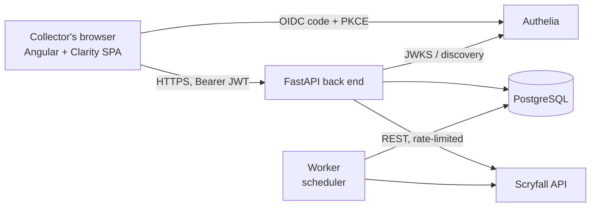

# 03 — Software Requirements Specification (SRS)

**Docs set version:** 0.2.0
**Document:** 03 Requirements Specification (structured after ISO/IEC/IEEE 29148 / IEEE 830)
**Status:** Draft
**Last updated:** 2026-10-31

Conventions: "shall" = mandatory. Each requirement has a stable ID, a MoSCoW priority, the user stories it serves (`Stories` column, must match `02` and `06`), and a verification method:
**U** unit test · **I** integration test (real PostgreSQL, fake external HTTP) · **C** contract test (OpenAPI) · **E** end-to-end browser test (Playwright) · **S** static/CI check · **M** manual checklist or review · **A** analysis.

---

## 1. Introduction

### 1.1 Purpose
Define complete, testable requirements for MTG Card Vault v1.0 so that developers, testers and LLM assistants share one precise understanding of the system.

### 1.2 Product scope
MTG Card Vault is a self-hosted, multi-user web application for *Magic: The Gathering* collectors. A collector signs in through Authelia, keeps a private vault of owned cards (printing, quantity, condition, finish), adds cards by webcam scanning (OCR + Scryfall fuzzy matching, always confirmed by the user) or manual search, and sees current prices and total collection value. Scope boundaries and non-goals: `01` §5.

### 1.3 Definitions
See Appendix A.

### 1.4 References
- Project documents `01`, `02`, `04`, `05`, `06` in this folder.
- Scryfall API documentation (https://scryfall.com/docs/api) and rate-limit/usage policy.
- OpenID Connect Core 1.0; OAuth 2.0 Authorization Code with PKCE (RFC 7636); JWT (RFC 7519); JWT BCP (RFC 8725); Problem Details (RFC 9457).
- Authelia OpenID Connect 1.0 provider documentation.
- VMware Clarity Design System documentation and design code.
- OWASP ASVS 4.x; WCAG 2.1 AA; Semantic Versioning 2.0.0; Conventional Commits 1.0.0.

### 1.5 Document overview
Section 2 describes the product context; section 3 holds functional requirements; section 4 non-functional requirements; section 5 data requirements; section 6 external interfaces; section 7 verification. Appendices hold the glossary and external-service rules.

---

## 2. Overall description

### 2.1 Product perspective
A three-tier web system with two external dependencies:

Details: `05` §3 and §5.

### 2.2 Product functions (summary)
Authentication and account · vault management · catalogue search · webcam scanning · pricing and valuation · Scryfall integration · API/operations.

### 2.3 User classes
Collector (primary), Operator, Maintainer, Scheduler: see `02` §1.

### 2.4 Operating environment
- Server: Linux (x86-64; arm64 best effort) with Docker Engine and Compose.
- Client: latest two stable versions of Chrome, Firefox, Edge and Safari (desktop), served over HTTPS (`NFR-CMP-01`).
- Runtime stack: Python (latest stable supported by dependencies), FastAPI, SQLAlchemy 2.x, Alembic, PostgreSQL (current supported major), Angular (latest supported by Clarity), VMware Clarity.

### 2.5 Design and implementation constraints
`01` §7 (`CON-01` … `CON-13`) apply in full.

### 2.6 Assumptions and dependencies
`01` §8 (`ASM-01` … `ASM-07`). External dependencies: Authelia, Scryfall, a webcam, a TLS-terminating reverse proxy.

### 2.7 Out of scope
`01` §5.2.

---

## 3. Functional requirements

### 3.1 Authentication, authorization and account (AUTH)

| ID | Requirement | Priority | Stories | Verification |
|---|---|---|---|---|
| FR-AUTH-01 | The front end shall authenticate users with the OIDC Authorization Code flow with PKCE (S256) against Authelia, requesting scopes `openid profile email offline_access` as needed, and shall keep tokens in memory only (never `localStorage`/`sessionStorage`). | Must | US-001 | E, U |
| FR-AUTH-02 | The front end shall sign the user out by discarding all tokens and calling Authelia's end-session endpoint. | Must | US-002 | E |
| FR-AUTH-03 | The front end shall renew the access token before it expires using refresh-token rotation, retry the interrupted request once, and send the user to sign-in when renewal fails. | Should | US-003 | U, E |
| FR-AUTH-04 | The API shall create a local user record keyed by the token's `sub` claim on the first authenticated request, idempotently and safely under concurrent requests (unique constraint plus upsert). | Must | US-004 | I |
| FR-AUTH-05 | The API shall validate the bearer JWT on every endpoint except health checks: signature against Authelia's JWKS (cached with key-rotation handling), algorithm from an allow-list (RS256; never `none`), `iss`, `aud` (the API's client/audience id), `exp` and `nbf` (≤ 60 s leeway). | Must | US-026 | U, I, C |
| FR-AUTH-06 | The API shall answer `401` with `WWW-Authenticate: Bearer` for a missing or invalid token and `403` when authenticated but not permitted; error bodies shall not disclose validation internals (details only in logs). | Must | US-026 | I, C |
| FR-AUTH-07 | The API shall allow cross-origin browser requests only from an explicit allow-list of front-end origins taken from configuration (no wildcard) and shall not use cookies for authentication. | Must | US-026 | I |
| FR-AUTH-08 | The API shall let an authenticated user permanently delete their user record and all their vault entries in one transaction; shared card cache rows are retained. | Should | US-032 | I, E |

### 3.2 Vault management (VLT)

| ID | Requirement | Priority | Stories | Verification |
|---|---|---|---|---|
| FR-VLT-01 | The API shall create a vault entry from `card_id` (Scryfall printing id), `quantity` (1–9999), `condition` (NM, LP, MP, HP, DMG; default NM) and `finish` (nonfoil, foil, etched; must be one of the printing's available finishes). | Must | US-005 | U, I, C |
| FR-VLT-02 | The API shall list the caller's entries with pagination (`page`, `page_size` default 50, max 200), default sort by date added (newest first) and a total count; each item includes the cached card summary and unit price. | Must | US-006 | I, C |
| FR-VLT-03 | The API shall update an entry's `quantity`, `condition` and `finish`; if the new combination equals another entry of the same user, the two shall be merged (quantities summed) atomically. | Must | US-007 | U, I |
| FR-VLT-04 | The API shall delete an entry; deleting a non-existing entry answers `404`. | Must | US-008 | I |
| FR-VLT-05 | The API shall filter the caller's entries by name text (case- and accent-insensitive contains), set code, colour identity, rarity and type line, and sort by name, set, price, date added or quantity, ascending or descending. | Should | US-009 | I |
| FR-VLT-06 | The system shall guarantee at most one entry per (user, card, condition, finish); adding an existing combination shall increase its quantity, failing with a validation error if the total would exceed 9999. | Must | US-010 | U, I |
| FR-VLT-07 | Every vault operation shall be scoped to the user derived from the token's `sub`, never from request data; accessing another user's entry shall answer `404`. | Must | US-011 | I, E |

### 3.3 Catalogue (CAT)

| ID | Requirement | Priority | Stories | Verification |
|---|---|---|---|---|
| FR-CAT-01 | The API shall search cards by free text through Scryfall's search (unique cards), paginated, with a short-lived in-memory result cache (default 5 min). | Must | US-012 | U, I |
| FR-CAT-02 | The API shall support the filters set, colour, type and rarity, translating them server-side into Scryfall query syntax with strict input validation and escaping (no pass-through of raw query operators). | Should | US-013 | U, I |
| FR-CAT-03 | The API shall return card details by Scryfall id: names, mana cost, type line, oracle text, rarity, set, collector number, language, finishes, image URIs, prices. | Must | US-014 | I, C |
| FR-CAT-04 | The API shall list all printings of a card (by `oracle_id`) with set, collector number, language and finishes so the user can select the exact printing to add. | Must | US-005, US-014 | I |

### 3.4 Card scanning (SCN)

| ID | Requirement | Priority | Stories | Verification |
|---|---|---|---|---|
| FR-SCN-01 | The front end shall access the camera via `getUserMedia` after explicit user permission, offer device selection (remembered in the browser), show a live preview with a card-shaped (63 × 88 mm aspect) guide overlay, handle denial / no device, and stop all tracks when leaving the page. | Must | US-015 | E, M |
| FR-SCN-02 | The front end shall capture one frame on user action, downscale it to ≤ 1280 px on the longest side, encode it as JPEG (quality ≈ 0.85) and submit it as `multipart/form-data` to `POST /api/v1/scans`. | Must | US-016 | U, E |
| FR-SCN-03 | The API shall run OCR on fixed regions of interest (title band at the top; set code and collector number band at the bottom left) after preprocessing (grayscale, contrast normalisation, thresholding) and return the raw recognised text per region. | Must | US-016 | U, I |
| FR-SCN-04 | The API shall resolve OCR text to up to 5 Scryfall printing candidates ordered by confidence (0–1): an exact set + collector number match ranks first; otherwise fuzzy name search; confidence derives from string similarity and attribute agreement. | Must | US-016 | U, I |
| FR-SCN-05 | A scan shall never modify the vault; a card is added only after the user confirms a candidate and its condition, finish and quantity (which then follows `FR-VLT-01`). | Must | US-017 | E, I |
| FR-SCN-06 | Scan images shall be processed in memory only and shall never be written to disk, database, cache or logs; request bodies of the scan endpoint shall be excluded from access logging. | Must | US-018 | I, M |
| FR-SCN-07 | The front end shall let the user abandon a scan result and open the catalogue search pre-filled with the OCR title text. | Must | US-019 | E |
| FR-SCN-08 | The API shall enforce on scan uploads: size ≤ 2 MB, type verified by magic bytes as JPEG/PNG/WebP, ≤ 4096 px per side and ≤ 16 megapixels total (decompression-bomb guard), and a rate limit of 30 scans per user per minute (`429` + `Retry-After`). | Must | US-018 | U, I |

### 3.5 Pricing and valuation (PRC)

| ID | Requirement | Priority | Stories | Verification |
|---|---|---|---|---|
| FR-PRC-01 | The system shall store on each cached card the latest Scryfall prices `usd`, `usd_foil`, `usd_etched`, `eur`, `eur_foil`, `eur_etched` (nullable) and `prices_updated_at`. Only the latest value is kept (no history). | Must | US-020 | I |
| FR-PRC-02 | The API shall expose each entry's unit price chosen by its finish (nonfoil → `usd`/`eur`, foil → `usd_foil`/`eur_foil`, etched → `usd_etched`/`eur_etched`), the price timestamp, and an `unpriced` flag when no price exists. | Must | US-020 | U, I |
| FR-PRC-03 | The API shall provide a vault summary with total cards (sum of quantities), number of entries, total value in USD and EUR (Σ unit price × quantity, unpriced entries excluded) and the count of unpriced entries. | Must | US-021 | U, I |
| FR-PRC-04 | A scheduled job in the worker shall refresh prices (and card data) for all cached cards owned by at least one user, using Scryfall's collection endpoint in batches of up to 75 identifiers, at a configurable time (default daily 04:00 UTC), with retry/backoff and a summary log line. | Must | US-022 | I |
| FR-PRC-05 | When a card's `prices_updated_at` is older than 24 h and it is displayed (detail page or vault summary), the API shall trigger a non-blocking refresh, de-duplicated so that at most one refresh per card is in flight. | Should | US-023 | U, I |

### 3.6 Data integration (DAT)

| ID | Requirement | Priority | Stories | Verification |
|---|---|---|---|---|
| FR-DAT-01 | All Scryfall access shall go through one adapter that sets descriptive `User-Agent` and `Accept` headers, spaces requests ≥ 100 ms apart process-wide, honours `429`/`Retry-After` with exponential backoff and jitter, applies timeouts, and never forwards user-supplied raw URLs. | Must | US-024 | U, I |
| FR-DAT-02 | When a card is added to any vault, the system shall upsert a local snapshot of that printing (ids, names, set, collector number, language, rarity, type line, mana cost, colours, finishes, image URIs, prices, timestamps). Images are referenced from Scryfall's CDN by URL, not copied. | Must | US-005, US-024 | I |
| FR-DAT-03 | When Scryfall is unreachable, vault reads shall be served from the local cache with stale prices flagged, and catalogue/scan operations shall return a clear, typed "upstream unavailable" error (`503` problem document) instead of failing the whole request path. | Should | US-025 | I |

### 3.7 API and operations (API, OPS)

| ID | Requirement | Priority | Stories | Verification |
|---|---|---|---|---|
| FR-API-01 | All business endpoints shall live under `/api/v1`, be described by an OpenAPI 3.1 document at `/api/v1/openapi.json`, and breaking changes shall require a new version prefix. The Angular API client shall be generated from this document. | Must | US-027 | C, S |
| FR-API-02 | All errors shall use `application/problem+json` (RFC 9457) with `type`, `title`, `status`, `detail` and a `correlation_id`; validation errors list offending fields. | Must | US-027 | C, I |
| FR-OPS-01 | The API shall expose unauthenticated `GET /healthz` (process up) and `GET /readyz` (database reachable, else `503`). | Should | US-028 | I |
| FR-OPS-02 | The API and worker shall emit structured JSON logs with a per-request correlation id (accepted from `X-Request-ID` or generated), and shall redact tokens, secrets, image data and e-mail addresses. | Should | US-028 | U, M |
| FR-OPS-03 | All configuration shall come from environment variables (12-factor) validated at start-up (fail fast); database migrations (Alembic) shall run automatically before the API starts accepting traffic. | Must | US-029 | I, M |

---

## 4. Non-functional requirements

### 4.1 Security (SEC)

| ID | Requirement | Priority | Stories | Verification |
|---|---|---|---|---|
| NFR-SEC-01 | Authentication, session handling and access control shall meet the relevant OWASP ASVS Level 2 controls; a checklist mapping is kept in the repository and reviewed per release. The API trusts only Authelia-issued tokens whose audience is this API; browser access is limited to the configured front-end origin. (Limitation: a valid token held by a non-browser client is accepted — tokens, not network origin, are the security boundary.) | Must | US-001, US-026 | I, M |
| NFR-SEC-02 | All external traffic shall use TLS 1.2+ terminated at the reverse proxy; HSTS shall be enabled; plain HTTP shall redirect to HTTPS. | Must | US-029 | M |
| NFR-SEC-03 | No secret shall be committed; secret scanning (gitleaks) shall run on every PR and on full history in CI. | Must | US-030 | S |
| NFR-SEC-04 | Dependency audits (`pip-audit`, `npm audit`) shall run in CI; a release shall contain no known High or Critical vulnerability without a documented, time-boxed exception. | Must | US-030 | S |
| NFR-SEC-05 | Container images shall be scanned (Trivy) with no unfixed High/Critical findings at release, built from minimal base images, run as non-root, with no secrets baked in. | Must | US-029, US-030 | S |
| NFR-SEC-06 | The SPA shall be served with security headers (CSP without `unsafe-inline` scripts, `X-Content-Type-Options`, `Referrer-Policy`, `Permissions-Policy` allowing camera for self only, `frame-ancestors 'none'`). | Should | US-026 | I, M |
| NFR-SEC-07 | All input shall be validated by typed schemas; file uploads follow `FR-SCN-08`; SQL access only through the ORM / bound parameters; outbound calls only to configured hosts (SSRF prevention). | Must | US-018 | U, I |

### 4.2 Performance (PRF)

| ID | Requirement | Priority | Stories | Verification |
|---|---|---|---|---|
| NFR-PRF-01 | Listing a page of a vault of 10,000 entries shall have server-side p95 ≤ 300 ms (excluding network) on the reference deployment (2 vCPU, 2 GB RAM). | Must | US-006 | I (benchmark) |
| NFR-PRF-02 | End-to-end scan (capture → candidates displayed) shall be ≤ 5 s at p90 with a responsive Scryfall; OCR step ≤ 2 s at p90. | Should | US-016 | I (benchmark), M |
| NFR-PRF-03 | The SPA initial load shall reach Largest Contentful Paint ≤ 3 s on a broadband connection, with lazy-loaded feature modules. | Should | US-006 | M |

### 4.3 Reliability (REL)

| ID | Requirement | Priority | Stories | Verification |
|---|---|---|---|---|
| NFR-REL-01 | Failure of Scryfall shall not prevent signing in, listing, editing or deleting vault entries (`FR-DAT-03`). | Should | US-025 | I |
| NFR-REL-02 | Schema changes shall be Alembic migrations that are tested up and down; the operator documentation shall describe backing up and restoring PostgreSQL. | Must | US-029 | I, M |

### 4.4 Usability and accessibility (USA)

| ID | Requirement | Priority | Stories | Verification |
|---|---|---|---|---|
| NFR-USA-01 | The UI shall use VMware Clarity components, layouts, icons and design tokens in full compliance with the Clarity design code; custom CSS shall not override Clarity semantics. | Must | US-033 | M, S |
| NFR-USA-02 | The UI shall conform to WCAG 2.1 level AA: automated axe checks with no serious/critical violations in E2E runs, full keyboard operation, visible focus, sufficient contrast. | Should | US-033 | E, M |
| NFR-USA-03 | The UI shall be fully usable at widths ≥ 768 px; phone widths (≥ 360 px) are best effort. | Should | US-033 | E, M |
| NFR-USA-04 | The UI language is English in v1, with all user-visible strings externalised through Angular i18n so further languages can be added without code changes. | Could | US-033 | S |

### 4.5 Maintainability, testing and process (MNT, TST)

| ID | Requirement | Priority | Stories | Verification |
|---|---|---|---|---|
| NFR-MNT-01 | The project-owned quality gate (`scripts/quality_gate.py`, identical on developer machines via `scripts/run_local_gates.py` and in GitHub Actions) shall pass on every PR and on `main`: coverage of new code ≥ 80 %, duplicated lines ≤ 3 %, no open bugs or vulnerabilities (reliability and security rating A), no open Blocker/Critical issues, no security hotspot left to review, and maintainability rating A. SonarQube supplies analysis and issue data only; its own quality gate shall never decide pass or fail. Conditions whose data the token cannot read are reported as SKIPPED, never as passed. | Must | US-030 | S |
| NFR-MNT-02 | Static quality: Python with `ruff` (lint + format) and `mypy --strict`; TypeScript `strict` with ESLint; all clean in CI. | Must | US-030 | S |
| NFR-MNT-03 | The architecture rules of `05` §5 (layer dependency direction, ports/adapters) shall be enforced by automated import-contract tests (for example `import-linter`). | Should | US-030 | S |
| NFR-MNT-04 | Gitflow branch names, Conventional Commit messages and semantic-version tags shall be checked in CI; `main` and `develop` are protected branches requiring PRs and green checks. | Must | US-030 | S, M |
| NFR-TST-01 | The test pyramid shall consist of unit tests (fast, no I/O), integration tests (PostgreSQL via testcontainers, Scryfall and Authelia JWKS faked with HTTP mocks), contract tests (OpenAPI schema vs. implementation and generated client) and Playwright E2E tests of the main journeys (with a fake camera stream). | Must | US-030 | S |

### 4.6 Portability, privacy, legal, documentation, compatibility (PRT, PRV, LEG, DOC, CMP)

| ID | Requirement | Priority | Stories | Verification |
|---|---|---|---|---|
| NFR-PRT-01 | The full stack shall start with `docker compose up` on a clean Linux host with only Docker installed and an `.env` file; no host-installed language runtimes shall be required. | Must | US-029 | M |
| NFR-PRV-01 | The system shall store only the minimum personal data (`sub`, display name, optional e-mail from claims) plus the user's vault; camera images are never stored (`FR-SCN-06`); account deletion removes all personal data (`FR-AUTH-08`). | Must | US-018, US-032 | I, M |
| NFR-LEG-01 | The UI shall display attribution that data and images come from Scryfall and that the app is unofficial Fan Content not endorsed by Wizards of the Coast; Scryfall data shall not be placed behind a paywall; card images shall not be cropped, distorted or have artist/copyright removed. | Must | US-024 | M |
| NFR-DOC-01 | The documentation set shall always be synchronized as defined in `docs/README.md` §2, and `scripts/check_docs_sync.py` shall pass in CI. | Must | US-031 | S |
| NFR-CMP-01 | The SPA shall work on the latest two stable versions of Chrome, Firefox, Edge and Safari (desktop) and Chrome/Safari on tablets; camera features require a secure context. | Should | US-015 | E, M |

---

## 5. Data requirements (logical model)

Physical schema and ER diagram: `05` §5.4. Logical entities:

| Entity | Key attributes | Rules |
|---|---|---|
| **User** | `id` (UUID), `sub` (unique, from token), `display_name`, `email` (optional), `created_at`, `last_login_at` | Created on first login (`FR-AUTH-04`); deleted with all data on request (`FR-AUTH-08`). |
| **Card** (cached printing) | `scryfall_id` (UUID, primary key), `oracle_id`, `name`, `set_code`, `set_name`, `collector_number`, `lang`, `rarity`, `type_line`, `mana_cost`, `colors`, `finishes[]`, `image_uri_small/normal`, six price fields, `prices_updated_at`, `data_updated_at` | Shared by all users; contains no personal data; upserted from Scryfall (`FR-DAT-02`, `FR-PRC-01`). Language is an attribute of the printing, not of the entry. |
| **VaultEntry** | `id` (UUID), `user_id`, `card_id`, `quantity` (1–9999), `condition` (enum), `finish` (enum), `created_at`, `updated_at` | Unique (`user_id`, `card_id`, `condition`, `finish`) (`FR-VLT-06`); `finish` ∈ card's `finishes`; deleted with its user. |

Retention: vault data until the user deletes it; cached cards until no entry references them (periodic cleanup, optional); logs per operator policy (no personal content).

---

## 6. External interfaces

### 6.1 User interface
Angular SPA with Clarity. Main screens: sign-in required; Vault (datagrid with filters, summary header); Catalogue search and card detail (with printings); Scan (camera, candidates, confirm form); Account (delete). Standard Clarity states for loading/empty/error. Footer carries the attribution of `NFR-LEG-01`.

### 6.2 Software interfaces
| Interface | Direction | Protocol | Notes |
|---|---|---|---|
| Front end ↔ API | SPA → API | HTTPS REST, JSON, Bearer JWT | Endpoint catalogue in `05` §5.5. |
| API/SPA ↔ Authelia | Both | OIDC (discovery, authorize, token, JWKS, end-session) | Public OIDC client with PKCE for the SPA; the API is a resource server (audience). |
| API/Worker ↔ Scryfall | Outbound | HTTPS REST/JSON | Rules in Appendix B. |
| API/Worker ↔ PostgreSQL | Outbound | PostgreSQL wire protocol | Via SQLAlchemy; migrations by Alembic. |

### 6.3 Hardware interfaces
Webcam or phone camera through the browser's `getUserMedia`.

### 6.4 Communication interfaces
HTTPS only. The reverse proxy routes `/` to the SPA, `/api` to the API and Authelia on its own host/path.

---

## 7. Verification approach

Each requirement lists its method. The traceability matrix (`06`) maps every requirement to components and test levels. Release readiness = all **Must** requirements verified, all gates green (`01` §4.2).

---

## Appendix A — Glossary

| Term | Meaning |
|---|---|
| MTG | *Magic: The Gathering*, a trading card game by Wizards of the Coast. |
| Card (oracle card) | The abstract game card identified by its rules text; identified by `oracle_id`. |
| Printing | A card as printed in a given set with a collector number and language; identified by Scryfall's `id`. |
| Set / set code | A release (for example "Modern Horizons 2", code `mh2`). |
| Collector number | The number printed bottom-left, unique within a set (may include letters). |
| Finish | Surface treatment: `nonfoil`, `foil`, `etched`. A printing lists which finishes exist. |
| Condition | Physical grade: NM (Near Mint), LP (Lightly Played), MP (Moderately Played), HP (Heavily Played), DMG (Damaged). |
| Vault | The set of a user's entries; private to that user. |
| Entry | One row of a vault: printing + condition + finish + quantity. |
| Unpriced | An entry whose finish has no price in the cached data. |
| Scryfall | Public MTG card database and API (https://scryfall.com). |
| Authelia | Self-hosted authentication/authorization server acting here as an OpenID Connect provider. |
| OIDC / PKCE | OpenID Connect / Proof Key for Code Exchange: the browser-safe login flow without a client secret. |
| JWT / JWKS | JSON Web Token / JSON Web Key Set (the public keys used to verify signatures). |
| OCR | Optical character recognition: reading text from an image. |
| ROI | Region of interest: a fixed part of the card image (title band, collector band) where text is read. |
| Candidate | A possible printing proposed for a scan, with a confidence score. |
| Gitflow | Branching model with `main`, `develop`, `feature/*`, `release/*`, `hotfix/*`. |
| ADR | Architecture Decision Record. |

## Appendix B — Scryfall usage rules (binding on the design)

1. Send a meaningful `User-Agent` (app name/version and contact) and an `Accept` header on every request.
2. Keep at least 50–100 ms between requests (≤ 10 requests/second); we use ≥ 100 ms.
3. Cache data; refresh prices at most about once a day (Scryfall updates prices once per day).
4. Prefer the batch endpoint `POST /cards/collection` (≤ 75 identifiers) for refreshes.
5. Do not paywall Scryfall data; do not crop or distort images or remove artist/copyright; do not imply endorsement.
6. Treat `429` as a signal to back off; repeated abuse risks a ban.
