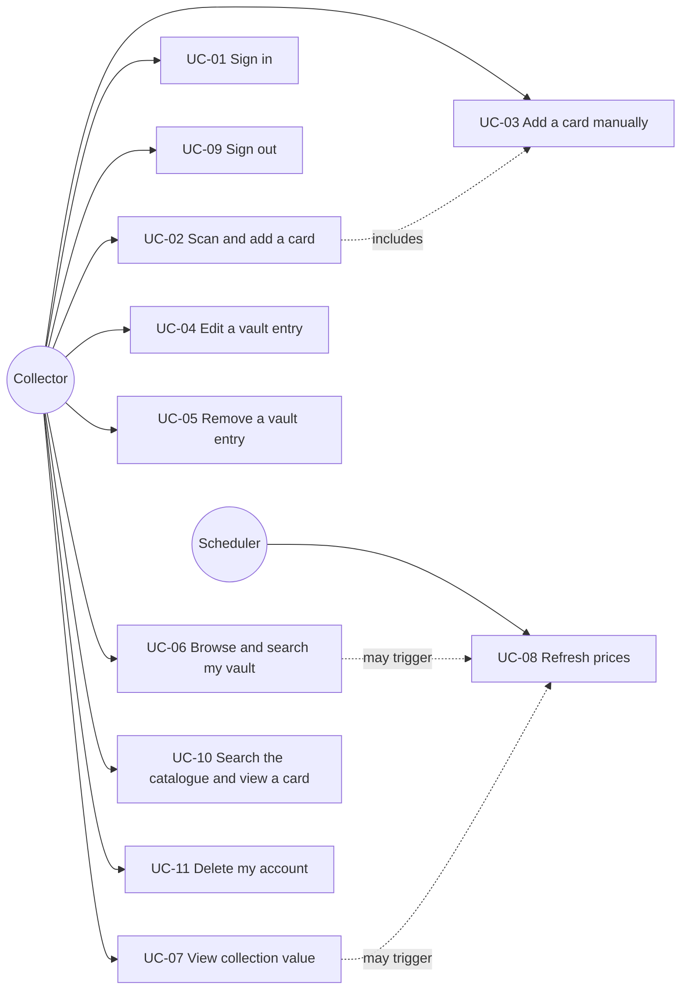

# 04 — Use Cases

**Docs set version:** 0.2.0
**Document:** 04 Use Cases (Cockburn "fully dressed" template)
**Status:** Draft
**Last updated:** 2026-10-31

Each use case lists the requirements (`Requirements:`) and stories (`Stories:`) it realises; these lines must exactly mirror `03`, `02` and the matrix `06`. Cross-cutting behaviours that apply to *every* call (JWT validation `FR-AUTH-05`/`FR-AUTH-06`, problem+json errors `FR-API-02`) are not repeated in each flow.

## 1. Actors

| Actor | Type | Description |
|---|---|---|
| Collector | Primary, human | Owns cards; uses the web app. |
| Operator | Primary, human | Deploys/runs the stack (not part of functional use cases; see `US-029`). |
| Scheduler | Primary, system | Timer in the worker that triggers price refreshes. |
| Authelia | Supporting, system | OIDC identity provider. |
| Scryfall | Supporting, system | MTG data and price provider. |
| Browser camera | Supporting, device | Webcam via `getUserMedia`. |

## 2. Use case overview

| ID | Name | Primary actor | Level |
|---|---|---|---|
| UC-01 | Sign in | Collector | User goal |
| UC-02 | Scan and add a card | Collector | User goal |
| UC-03 | Add a card manually | Collector | User goal |
| UC-04 | Edit a vault entry | Collector | User goal |
| UC-05 | Remove a vault entry | Collector | User goal |
| UC-06 | Browse and search my vault | Collector | User goal |
| UC-07 | View collection value | Collector | User goal |
| UC-08 | Refresh prices | Scheduler | System goal |
| UC-09 | Sign out | Collector | Subfunction |
| UC-10 | Search the catalogue and view a card | Collector | User goal |
| UC-11 | Delete my account | Collector | User goal |

---

## 3. Use case specifications

### UC-01 — Sign in
- **Requirements:** FR-AUTH-01, FR-AUTH-03, FR-AUTH-04, FR-AUTH-05
- **Stories:** US-001, US-003, US-004
- **Scope / level:** MTG Card Vault (system) / user goal
- **Primary actor:** Collector. **Supporting:** Authelia.
- **Goal:** Obtain an authenticated session to use the vault.
- **Preconditions:** The Collector has an Authelia account and is not signed in.
- **Trigger:** The Collector opens the application.
- **Main success scenario:**
  1. The SPA detects no valid session and starts the authorization code flow with PKCE, redirecting to Authelia.
  2. Authelia authenticates the Collector (password / second factor per its policy).
  3. Authelia redirects back with an authorization code.
  4. The SPA exchanges the code (with the PKCE verifier) for tokens and keeps them in memory.
  5. The SPA calls `GET /api/v1/me` with the access token.
  6. The API validates the JWT (signature, issuer, audience, expiry).
  7. The API creates the user record if it does not exist (keyed by `sub`) and returns the profile.
  8. The SPA shows the vault page.
- **Extensions:**
  - 2a. Authentication fails or is cancelled → Authelia shows its error / returns `error=access_denied`; the SPA shows "sign-in required" with a retry button.
  - 4a. The code exchange fails (state mismatch, expired code) → the SPA aborts, clears state and restarts from step 1 once, then shows an error.
  - 6a. The token is invalid or expired → the API returns `401`; the SPA tries a silent renewal (3.x below) or restarts the flow.
  - 7a. A concurrent first request already created the user → the unique constraint / upsert makes the call return the existing user.
  - *a. While active, before expiry (`FR-AUTH-03`): the SPA renews the access token via refresh-token rotation and retries the failed call once; if renewal fails it restarts the flow and returns to the original page afterwards.
- **Postconditions (success):** The SPA holds valid tokens in memory; the user record exists. **(Failure):** No tokens are held; no data is exposed.
- **Business rules:** Tokens are never persisted in web storage. Only tokens issued by Authelia for this API's audience are accepted.

### UC-02 — Scan and add a card
- **Requirements:** FR-VLT-01, FR-VLT-06, FR-SCN-01, FR-SCN-02, FR-SCN-03, FR-SCN-04, FR-SCN-05, FR-SCN-06, FR-SCN-07, FR-SCN-08, FR-DAT-01, FR-DAT-02, NFR-PRF-02, NFR-CMP-01
- **Stories:** US-005, US-010, US-015, US-016, US-017, US-018, US-019, US-024
- **Scope / level:** System / user goal
- **Primary actor:** Collector. **Supporting:** Browser camera, Scryfall.
- **Goal:** Add a physical card to the vault by showing it to the webcam.
- **Preconditions:** The Collector is signed in (UC-01) on a secure (HTTPS) origin and owns a camera.
- **Trigger:** The Collector opens the Scan page.
- **Main success scenario:**
  1. The SPA requests camera permission; the Collector allows it.
  2. The SPA shows a live preview with a card-shaped guide overlay.
  3. The Collector aligns the card in the guide and presses **Scan**.
  4. The SPA captures a frame, downscales it (≤ 1280 px), encodes JPEG and uploads it to `POST /api/v1/scans`.
  5. The API validates size, type (magic bytes) and dimensions, and applies the rate limit.
  6. The API runs OCR on the title band and the set/collector-number band, in memory.
  7. The API queries Scryfall through the rate-limited adapter: exact set + collector number if present, otherwise fuzzy name search.
  8. The API returns the OCR text and up to 5 candidates with confidence scores; the image is discarded.
  9. The SPA shows the candidates with card images and the OCR text.
  10. The Collector selects the right printing, sets condition, finish and quantity, and confirms.
  11. The SPA calls `POST /api/v1/vault/entries`.
  12. The API upserts the card snapshot in the local cache and creates the entry, or increases the quantity if the same (card, condition, finish) exists.
  13. The SPA confirms success and leaves the camera ready for the next card.
- **Extensions:**
  - 1a. Permission denied / no camera / insecure origin → the SPA explains why and offers manual search (→ UC-03).
  - 1b. Several cameras → the Collector picks one; the choice is remembered in the browser.
  - 5a. File too large, wrong type or too many pixels → `413`/`415`/`422` problem response; the SPA asks to retry.
  - 5b. Rate limit exceeded → `429` with `Retry-After`; the SPA asks to wait.
  - 6a. OCR finds no usable title → the API returns an empty candidate list with a reason; the SPA offers retry or manual search.
  - 7a. Scryfall is unavailable → `503` problem response "upstream unavailable"; the SPA offers retry or manual search later.
  - 9a. No candidate is correct → the Collector chooses "None of these — search manually" → UC-03 with the search box pre-filled with the OCR title.
  - 10a. The chosen finish is not available for the printing → the API returns a validation error; the form restricts finishes to the available ones.
  - 12a. The new quantity would exceed 9999 → validation error; nothing is changed.
- **Postconditions (success):** The vault reflects the new/increased entry; the card snapshot is cached. **(Failure/any):** No image is stored anywhere; the vault is unchanged unless step 11-12 completed.
- **Business rules:** A scan never changes the vault by itself (`FR-SCN-05`). Condition defaults to NM. Target: p90 ≤ 5 s from step 4 to 9.

### UC-03 — Add a card manually
- **Requirements:** FR-VLT-01, FR-VLT-06, FR-CAT-04, FR-SCN-07, FR-DAT-02
- **Stories:** US-005, US-010, US-019
- **Scope / level:** System / user goal
- **Primary actor:** Collector. **Supporting:** Scryfall.
- **Goal:** Add a specific printing to the vault without the camera.
- **Preconditions:** The Collector is signed in.
- **Trigger:** The Collector chooses "Add card" or arrives from UC-02 extension 9a.
- **Main success scenario:**
  1. The Collector searches the catalogue (UC-10) and opens a card.
  2. The SPA lists the card's printings (`FR-CAT-04`).
  3. The Collector selects a printing and enters condition, finish and quantity.
  4. The SPA calls `POST /api/v1/vault/entries`.
  5. The API caches the card snapshot and creates or merges the entry.
  6. The SPA confirms and updates the vault count.
- **Extensions:**
  - 1a. No results → empty state with a hint to refine the search.
  - 4a. Validation error (quantity range, unavailable finish) → inline messages; nothing is saved.
  - 5a. Scryfall unreachable but the printing is already cached → the add proceeds from the cache.
- **Postconditions (success):** Entry exists with the summed quantity. **(Failure):** Vault unchanged.

### UC-04 — Edit a vault entry
- **Requirements:** FR-VLT-03
- **Stories:** US-007
- **Primary actor:** Collector.
- **Goal:** Correct quantity, condition or finish of an entry.
- **Preconditions:** Signed in; the entry exists and belongs to the Collector.
- **Trigger:** The Collector selects "Edit" on an entry.
- **Main success scenario:**
  1. The SPA shows quantity, condition and finish controls with current values.
  2. The Collector changes values and saves.
  3. The SPA calls `PATCH /api/v1/vault/entries/{id}`.
  4. The API validates, updates the entry and its `updated_at`.
  5. The SPA shows the updated entry.
- **Extensions:**
  - 4a. The new (condition, finish) equals another entry of the same card → the API merges both in one transaction (quantities summed, capped at 9999) and returns the merged entry; the SPA refreshes the list.
  - 4b. Entry not found (deleted elsewhere, or not owned) → `404`; the SPA refreshes the list.
  - 4c. Validation error → inline message; nothing saved.
- **Postconditions:** Entry (or merged entry) reflects the change.

### UC-05 — Remove a vault entry
- **Requirements:** FR-VLT-04
- **Stories:** US-008
- **Primary actor:** Collector.
- **Goal:** Remove a card entry from the inventory.
- **Preconditions:** Signed in; the entry exists and is owned by the Collector.
- **Trigger:** The Collector selects "Remove".
- **Main success scenario:**
  1. The SPA asks for confirmation.
  2. The Collector confirms.
  3. The SPA calls `DELETE /api/v1/vault/entries/{id}`.
  4. The API deletes the entry and answers `204`.
  5. The SPA removes the row and updates the summary.
- **Extensions:**
  - 2a. The Collector cancels → nothing happens.
  - 4a. Entry missing / not owned → `404`; the SPA refreshes the list.

### UC-06 — Browse and search my vault
- **Requirements:** FR-VLT-02, FR-VLT-05, FR-PRC-02, FR-DAT-03, NFR-PRF-01, NFR-REL-01
- **Stories:** US-006, US-009, US-020, US-025
- **Primary actor:** Collector.
- **Goal:** See and find the cards I own, with prices.
- **Preconditions:** Signed in.
- **Trigger:** The Collector opens the Vault page.
- **Main success scenario:**
  1. The SPA calls `GET /api/v1/vault/entries?page=1&page_size=50`.
  2. The API returns the Collector's entries with card summaries, unit prices and the total count.
  3. The SPA renders a Clarity datagrid with image, name, set, number, finish, condition, quantity and price.
  4. The Collector types a name, picks filters (set, colour, rarity, type) and a sort order.
  5. The SPA re-queries with those parameters; the API returns the matching page.
- **Extensions:**
  - 2a. The vault is empty → empty state with links to Scan and Search.
  - 2b. Scryfall is unavailable → data still comes from the local cache; prices older than 24 h are flagged "stale" (`FR-DAT-03`).
  - 2c. Some cards have stale prices → the API triggers background refresh (UC-08 behaviour) without delaying the response.
  - 5a. No match → "no entries match your filters" state with a clear-filters action.

### UC-07 — View collection value
- **Requirements:** FR-PRC-03, FR-PRC-05
- **Stories:** US-021, US-023
- **Primary actor:** Collector.
- **Goal:** Know the total size and worth of the collection.
- **Preconditions:** Signed in.
- **Trigger:** The Vault page loads its header, or the Collector opens the summary.
- **Main success scenario:**
  1. The SPA calls `GET /api/v1/vault/summary`.
  2. The API computes total cards, number of entries, value in USD and EUR, and number of unpriced entries.
  3. The SPA shows the figures and, if any, "N entries unpriced — total is a lower bound".
- **Extensions:**
  - 2a. Some prices are older than 24 h → the API starts a de-duplicated background refresh and returns current cached figures; a later load shows the refreshed value.
  - 2b. Empty vault → zeros are shown.

### UC-08 — Refresh prices
- **Requirements:** FR-PRC-01, FR-PRC-04, FR-DAT-01
- **Stories:** US-020, US-022, US-024
- **Primary actor:** Scheduler. **Supporting:** Scryfall.
- **Goal:** Keep prices of owned cards current without user action.
- **Preconditions:** The worker is running; the schedule (default 04:00 UTC) is due, or a lazy refresh was requested.
- **Trigger:** The timer fires (or the API requests a refresh of specific stale cards).
- **Main success scenario:**
  1. The worker selects cached cards referenced by at least one entry (all, or the stale subset).
  2. It groups them into batches of up to 75 identifiers.
  3. For each batch it calls Scryfall's collection endpoint through the rate-limited adapter.
  4. It updates the stored prices, card data and `prices_updated_at`.
  5. It logs a summary: updated, unchanged, failed.
- **Extensions:**
  - 3a. HTTP 429 → wait per `Retry-After`, then retry with exponential backoff and jitter.
  - 3b. Network error or 5xx after retries → the batch is marked failed, others continue; failures are retried at the next run.
  - 3c. A card is missing from the response (`not_found`) → its record is left unchanged and counted in the log.
- **Postconditions:** Successful batches are committed; failures never corrupt existing data.

### UC-09 — Sign out
- **Requirements:** FR-AUTH-02
- **Stories:** US-002
- **Primary actor:** Collector.
- **Goal:** End the session.
- **Preconditions:** Signed in.
- **Trigger:** The Collector chooses "Sign out".
- **Main success scenario:**
  1. The SPA discards tokens from memory.
  2. The SPA redirects to Authelia's end-session endpoint.
  3. Authelia ends its session and redirects to the post-logout page.
  4. The SPA shows the signed-out page.
- **Extensions:**
  - 2a. Authelia is unreachable → the local session is still cleared; the SPA informs the Collector that the identity-provider session may remain.

### UC-10 — Search the catalogue and view a card
- **Requirements:** FR-CAT-01, FR-CAT-02, FR-CAT-03, FR-CAT-04, FR-PRC-02, FR-PRC-05, FR-DAT-01, FR-DAT-03
- **Stories:** US-012, US-013, US-014, US-023, US-024, US-025
- **Primary actor:** Collector. **Supporting:** Scryfall.
- **Goal:** Find a card and see its details, prices and printings.
- **Preconditions:** Signed in.
- **Trigger:** The Collector opens Catalogue and types a query.
- **Main success scenario:**
  1. The Collector enters text and optionally filters (set, colour, type, rarity).
  2. The SPA calls `GET /api/v1/catalog/cards?q=…`.
  3. The API validates and translates the query, checks its short-lived cache, otherwise queries Scryfall through the adapter.
  4. The API returns a page of matching cards.
  5. The Collector opens a card; the SPA calls `GET /api/v1/catalog/cards/{id}` and `…/printings`.
  6. The SPA shows details, prices and all printings, with an "Add to vault" action (→ UC-03).
- **Extensions:**
  - 3a. Invalid characters or too-long query → `422` problem response.
  - 4a. No results → empty state.
  - 3b. Scryfall unavailable → `503` problem "catalogue temporarily unavailable" and a friendly message (`FR-DAT-03`).
  - 5a. Card prices older than 24 h → background refresh is triggered (`FR-PRC-05`).

### UC-11 — Delete my account
- **Requirements:** FR-AUTH-08
- **Stories:** US-032
- **Primary actor:** Collector.
- **Goal:** Permanently remove my account and data.
- **Preconditions:** Signed in.
- **Trigger:** The Collector opens Account and chooses "Delete my account".
- **Main success scenario:**
  1. The SPA explains the consequences and asks the Collector to type their username.
  2. The Collector confirms.
  3. The SPA calls `DELETE /api/v1/me`.
  4. The API deletes all the user's entries and the user record in one transaction and answers `204`.
  5. The SPA signs the Collector out (UC-09).
- **Extensions:**
  - 2a. The typed username does not match → the button stays disabled.
  - 4a. A database error → the transaction rolls back; the user is told nothing was deleted and may retry.
- **Postconditions:** No personal data or vault data remains; shared cached card rows remain. The Authelia identity is not deleted (managed by the Operator).
