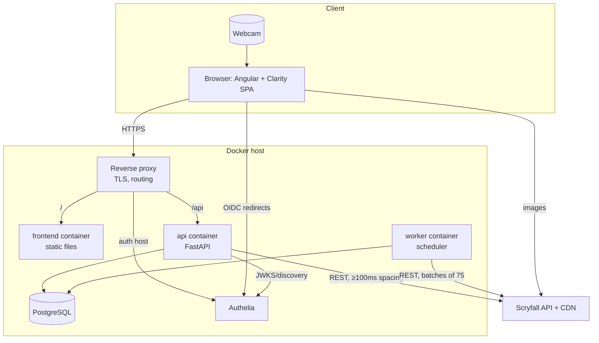
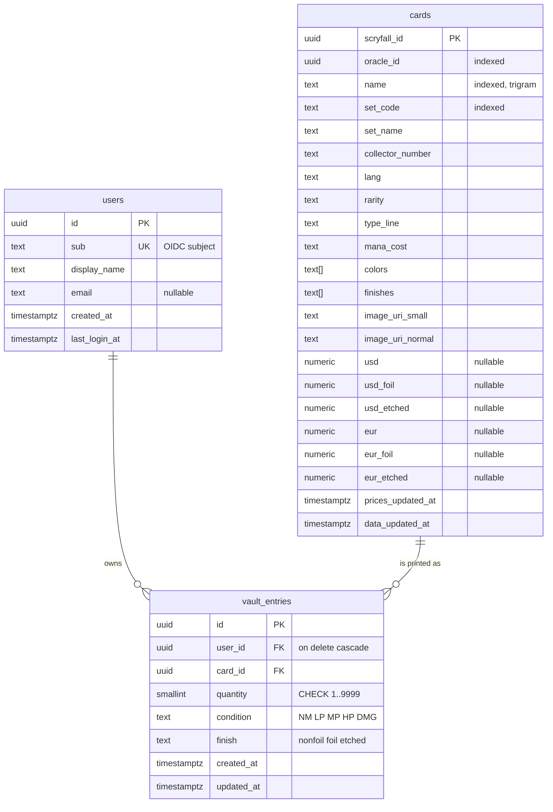
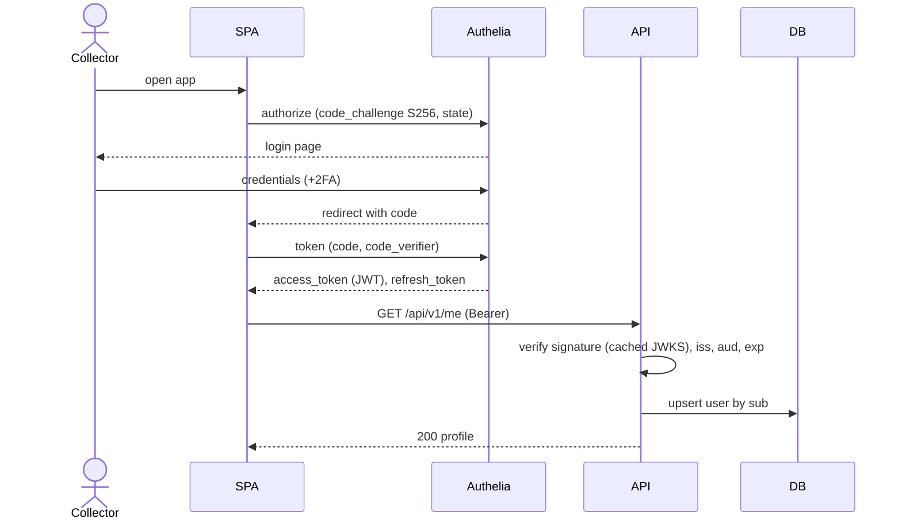
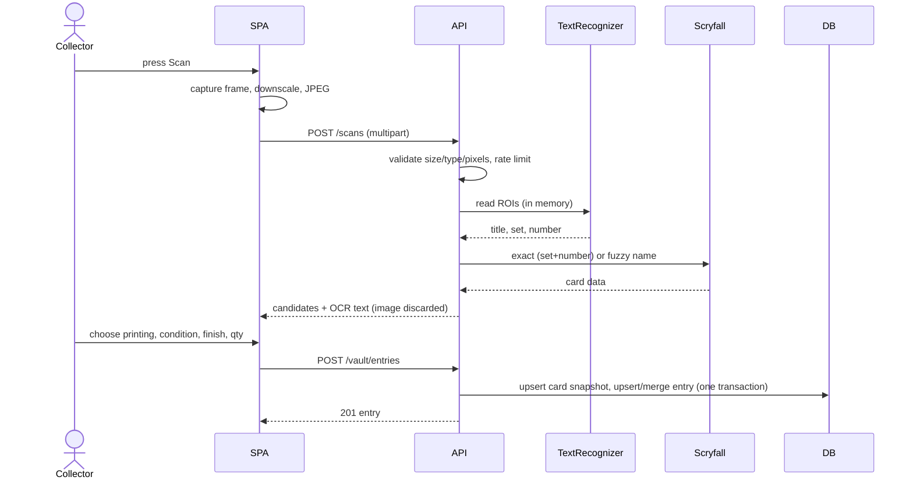
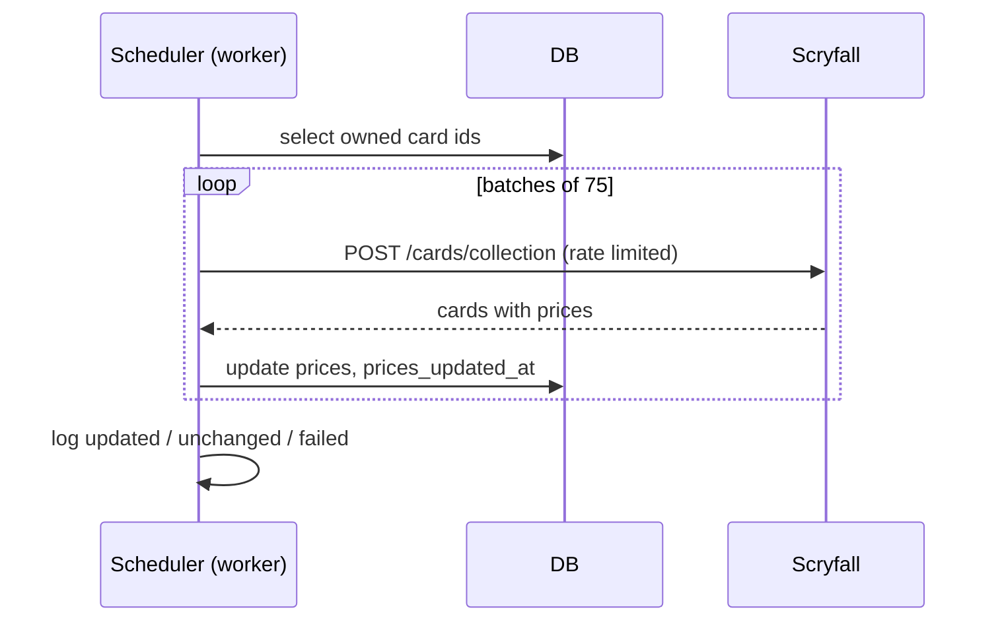
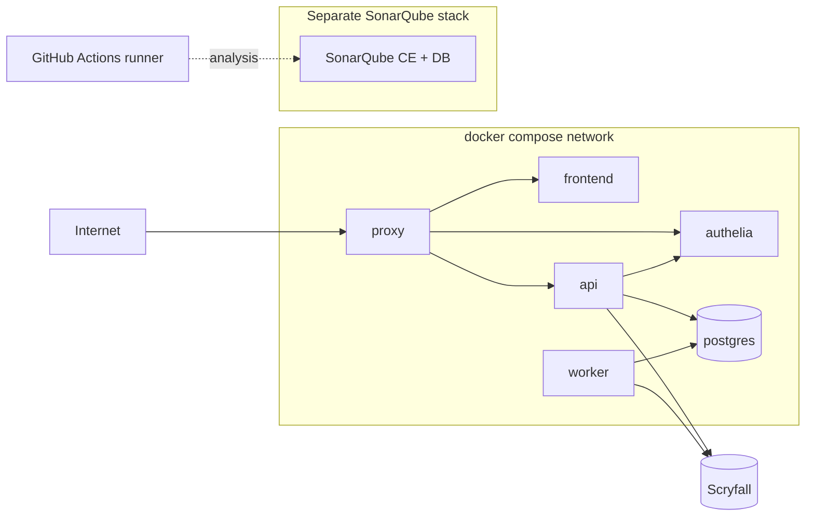

# 05 — Architecture Plan

**Docs set version:** 0.1.0
**Document:** 05 Architecture Plan (arc42 template, 12 sections; decisions as ADRs; diagrams in Mermaid)
**Status:** Draft
**Last updated:** 2026-10-31

Technology versions are intentionally written as "latest stable supported by …"; exact pins live in `pyproject.toml` / `package.json` and are recorded in the changelog when they change.

---

## 1. Introduction and goals

### 1.1 Requirements overview
MTG Card Vault lets collectors sign in through Authelia, keep a private vault of owned MTG cards, add cards by webcam (OCR + Scryfall matching, user-confirmed) or manual search, and see current prices and total value. Authoritative statements: `01` (why/scope), `02` (stories), `03` (requirements), `04` (flows).

### 1.2 Quality goals (top five, in priority order)

| # | Quality goal | Meaning here | Requirements |
|---|---|---|---|
| 1 | Security & privacy | Only authenticated users; strict data isolation; no scan images stored. | NFR-SEC-01, NFR-SEC-05, NFR-PRV-01 |
| 2 | Maintainability / testability | SOLID, DRY, KISS, YAGNY; ports and adapters; quality gate. | NFR-MNT-01, NFR-MNT-03, NFR-TST-01 |
| 3 | Correctness of card data | User-confirmed matches, Scryfall as source of truth. | FR-SCN-05, FR-DAT-02 |
| 4 | Resilience to external failure | Scryfall outage never locks the vault. | NFR-REL-01, FR-DAT-03 |
| 5 | Usability & accessibility | Clarity design code, WCAG 2.1 AA. | NFR-USA-01, NFR-USA-02 |

### 1.3 Stakeholders
See `01` §3 (`STK-01` … `STK-06`). Architecture-relevant expectations: STK-01 wants clean, demonstrable engineering; STK-03 wants a one-command deployment; STK-04/05 impose interface rules.

---

## 2. Constraints

| Type | Constraint | Source |
|---|---|---|
| Technical | Python/FastAPI back end; Angular + Clarity front end; REST; PostgreSQL; docker compose. | CON-01, CON-02, CON-03, CON-10 |
| Technical | Authelia as OIDC provider; JWT on every call. | CON-04 |
| Technical | HTTPS required for camera access. | CON-11 |
| Organizational | GitHub public repo, gitflow, semver, atomic commits, GitHub Actions. | CON-05, CON-06 |
| Organizational | SonarQube self-hosted quality gate. | CON-07 |
| Principles | SOLID, DRY, KISS, YAGNY; full test suite. | CON-08 |
| External | Scryfall API rules and legal terms. | CON-09 |
| Privacy | Webcam images never persisted. | CON-12 |
| Conventions | Monorepo with `backend/`, `frontend/`, `docs/`, `deploy/`, `scripts/`, `.github/`. | ADR-001 |

---

## 3. Context and scope

### 3.1 Business context

| Partner | Inputs to the system | Outputs from the system |
|---|---|---|
| Collector | Credentials (to Authelia), camera frames, search text, vault edits | Vault views, candidates, prices, totals |
| Authelia | ID/access/refresh tokens, JWKS, discovery document | Authorization requests, end-session |
| Scryfall | Card data, printings, prices, images (CDN) | Search / lookup / collection requests |
| Operator | Configuration (`.env`), upgrades | Logs, health endpoints |

### 3.2 Technical context



Channel table: browser↔proxy HTTPS/443 · proxy↔api HTTP on internal network · api↔db TCP/5432 internal · api/worker↔Scryfall HTTPS to `api.scryfall.com` only · browser↔Scryfall CDN HTTPS for `` only (CSP allows `cards.scryfall.io`).

---

## 4. Solution strategy

| Goal / problem | Approach | Decision |
|---|---|---|
| Separate concerns, keep tests fast | Layered architecture with ports (interfaces) and adapters at the edges; domain logic free of frameworks. | ADR-006 |
| Prove the caller's identity on every call | Authelia OIDC; SPA uses code + PKCE; API validates Authelia-signed JWT locally via cached JWKS. | ADR-003 |
| Reduce manual data entry | Browser captures a frame; server-side OCR on fixed regions; Scryfall fuzzy match; user confirms. | ADR-004 |
| Accurate, current data without heavy infrastructure | Cache only owned cards; refresh daily in batches and lazily when stale. | ADR-007, ADR-012 |
| Protect privacy | Frames processed in memory and discarded. | ADR-008 |
| Avoid hand-written glue | OpenAPI is the contract; Angular client generated from it. | ADR-009, ADR-013 |
| Keep quality enforceable | Quality gate + security scans + import contracts + docs sync in CI. | ADR-010, ADR-011, ADR-014 |
| Simple operation | One compose file; env-based config; migrations on start. | ADR-001, ADR-005 |

---

## 5. Building block view

### 5.1 Level 1 — containers

| Container | Responsibility | Tech |
|---|---|---|
| `frontend` | SPA: UI, OIDC login, camera capture, generated API client. Served as static files by an unprivileged web server. | Angular, Clarity |
| `api` | REST API: authentication, use cases, Scryfall access, OCR, persistence. | Python, FastAPI |
| `worker` | Scheduled jobs (price refresh); same codebase and image as `api`, different entry command. | Python, APScheduler |
| `db` | Persistent data. | PostgreSQL |
| `authelia` | Identity provider (OIDC). | Authelia |
| `proxy` | TLS termination, routing, security headers. | Traefik or Caddy (OQ-03) |

### 5.2 Level 2 — back end (`backend/`)

```
backend/
├── pyproject.toml            # uv/pip metadata, ruff, mypy, pytest, import-linter config
├── alembic.ini
├── migrations/               # Alembic revisions
├── src/mtgvault/
│   ├── main.py               # composition root: builds app, wires dependencies
│   ├── config.py             # typed settings (pydantic-settings), fail fast
│   ├── logging.py            # JSON logging, correlation id, redaction
│   ├── api/                  # DRIVING ADAPTER (HTTP)
│   │   ├── v1/               # routers: me, vault, catalog, scans, health
│   │   ├── schemas/          # Pydantic request/response DTOs
│   │   ├── dependencies.py   # auth dependency, current user, service providers
│   │   └── errors.py         # exception -> problem+json mapping
│   ├── application/          # USE CASES + PORTS
│   │   ├── services/         # VaultService, CatalogService, ScanService,
│   │   │                     # PricingService, UserService
│   │   └── ports.py          # Protocols: CardRepository, VaultRepository,
│   │                         # UserRepository, CardDataProvider, TextRecognizer,
│   │                         # TokenVerifier, Clock, UnitOfWork
│   ├── domain/               # PURE BUSINESS RULES (no framework imports)
│   │   ├── model.py          # User, Card, VaultEntry, Candidate
│   │   ├── values.py         # Condition, Finish, Money, Quantity
│   │   └── rules.py          # merge rules, price selection, value calculation
│   ├── adapters/             # DRIVEN ADAPTERS (implement ports)
│   │   ├── persistence/      # SQLAlchemy models, repositories, unit of work
│   │   ├── scryfall/         # HTTP client, rate limiter, mapper
│   │   ├── ocr/              # preprocessing + engine (OQ-02)
│   │   └── auth/             # JWKS cache, JWT verifier (Authelia)
│   └── worker/               # scheduler entry point and jobs
└── tests/
    ├── unit/                 # pure, no I/O
    ├── integration/          # PostgreSQL (testcontainers) + HTTP fakes
    └── contract/             # OpenAPI conformance
```

**Dependency rules (enforced by import-linter, `NFR-MNT-03`):**
`api → application → domain`; `adapters → application, domain` (adapters implement ports); `domain` imports nothing from the project; `application` never imports `api` or `adapters`; only `main.py` knows concrete adapters (dependency injection through FastAPI `Depends`).

**How the principles are applied**

| Principle | Concrete application |
|---|---|
| **S**ingle responsibility | One service per use-case family; routers only translate HTTP ↔ DTO ↔ service call; mappers separate from clients. |
| **O**pen/closed | New OCR engine or recognition strategy = new adapter implementing `TextRecognizer`; no change to `ScanService`. |
| **L**iskov | All adapters honour the port contracts (shared contract tests run against fakes and real adapters). |
| **I**nterface segregation | Small ports (`CardDataProvider` is read-only; `Clock` only `now()`), not one fat repository. |
| **D**ependency inversion | Services depend on `Protocol`s in `application/ports.py`; concrete classes are injected at the composition root. |
| **DRY** | One Scryfall client, one error mapper, one pagination schema, OpenAPI-generated front-end client, IDs in docs not copied text. |
| **KISS** | No CQRS, no event bus, no message broker; plain services and a SQL database. |
| **YAGNY** | No price history, no sharing, no bulk import, no plugin system (see `01` §5.2). |

### 5.3 Level 2 — front end (`frontend/`)

```
frontend/src/app/
├── core/            # auth (OIDC), HTTP interceptors (token, errors), config, layout shell
├── api/             # GENERATED client from /api/v1/openapi.json (not hand-edited)
├── shared/          # small reusable presentational pieces built on Clarity
└── features/        # lazy-loaded feature areas
    ├── vault/       # datagrid, filters, summary, edit/remove
    ├── catalog/     # search, card detail, printings
    ├── scan/        # camera service, capture, candidates, confirm form
    └── account/     # profile, delete account
```

Rules: feature modules do not import each other (communicate via services in `core` or routing); all server calls go through the generated client; state is local to features using Angular signals/services (no global store until proven necessary — YAGNY); UI only uses Clarity components and tokens (`NFR-USA-01`).

### 5.4 Data model (physical)



Constraints and indexes: `UNIQUE (user_id, card_id, condition, finish)` (`FR-VLT-06`); `INDEX (user_id, created_at DESC)` for default listing; trigram index on `cards.name` for case/accent-insensitive search (`FR-VLT-05`); `users.sub` unique (`FR-AUTH-04`). Money uses `NUMERIC(10,2)`; never floating point. Language is a property of the printing (`cards.lang`), not of the entry.

### 5.5 REST API catalogue (`/api/v1`)

All endpoints require a valid bearer JWT (`FR-AUTH-05`) unless marked *public*. Errors are `application/problem+json` (`FR-API-02`).

| Method & path | Purpose | Requirement |
|---|---|---|
| `GET /me` | Current user profile; provisions the user on first call. | FR-AUTH-04 |
| `DELETE /me` | Delete my account and data. | FR-AUTH-08 |
| `GET /vault/entries` | List/filter/sort/paginate my entries. | FR-VLT-02, FR-VLT-05 |
| `POST /vault/entries` | Add (or merge into) an entry. | FR-VLT-01, FR-VLT-06 |
| `PATCH /vault/entries/{id}` | Edit quantity/condition/finish (may merge). | FR-VLT-03 |
| `DELETE /vault/entries/{id}` | Remove an entry. | FR-VLT-04 |
| `GET /vault/summary` | Totals and value, unpriced count. | FR-PRC-03 |
| `GET /catalog/cards` | Search (q, set, colors, type, rarity, page). | FR-CAT-01, FR-CAT-02 |
| `GET /catalog/cards/{scryfall_id}` | Card detail with prices. | FR-CAT-03 |
| `GET /catalog/cards/{scryfall_id}/printings` | All printings of the card. | FR-CAT-04 |
| `POST /scans` | Upload one frame; returns OCR text and ≤ 5 candidates. | FR-SCN-03, FR-SCN-04, FR-SCN-08 |
| `GET /healthz`, `GET /readyz` (*public*, outside `/api/v1`) | Liveness / readiness. | FR-OPS-01 |
| `GET /openapi.json` | API contract. | FR-API-01 |

### 5.6 Component codes (used by the traceability matrix)

| Code | Component | Location |
|---|---|---|
| FE-CORE | Front-end shell, config, interceptors, i18n | `frontend/src/app/core` |
| FE-AUTH | OIDC login/logout/renewal | `frontend/src/app/core/auth` |
| FE-VAULT | Vault feature (grid, filters, summary, edit/remove) | `features/vault` |
| FE-CATALOG | Catalogue feature | `features/catalog` |
| FE-SCAN | Camera, capture, candidates, confirm | `features/scan` |
| FE-ACCOUNT | Account feature | `features/account` |
| API-CORE | App factory, config, logging, errors, health, OpenAPI | `backend/src/mtgvault/{main,config,logging}.py`, `api/errors.py`, `api/v1/health.py` |
| API-AUTH | Auth dependency, user service | `api/dependencies.py`, `application/services/user` |
| API-VAULT | Vault routers/service/rules | `api/v1/vault.py`, `application/services/vault`, `domain/rules.py` |
| API-CATALOG | Catalogue routers/service | `api/v1/catalog.py`, `application/services/catalog` |
| API-SCAN | Scan router/service | `api/v1/scans.py`, `application/services/scan` |
| API-PRICING | Pricing service and summary | `application/services/pricing` |
| ADP-SCRYFALL | Scryfall client, limiter, mapper | `adapters/scryfall` |
| ADP-OCR | OCR preprocessing and engine | `adapters/ocr` |
| ADP-JWT | JWKS cache and token verification | `adapters/auth` |
| ADP-DB | Repositories, models, unit of work, migrations | `adapters/persistence`, `migrations` |
| WRK | Scheduler and jobs | `backend/src/mtgvault/worker` |
| INF-CI | GitHub Actions, quality/security tooling | `.github/workflows`, `sonar-project.properties` |
| INF-DEPLOY | Compose, proxy, Authelia config, Dockerfiles | `deploy/`, `backend/Dockerfile`, `frontend/Dockerfile` |
| DOCS | Documentation set and sync script | `docs/`, `scripts/check_docs_sync.py` |

---

## 6. Runtime view

### 6.1 Sign in and first request (UC-01)



### 6.2 Scan and add a card (UC-02)



### 6.3 Scheduled price refresh (UC-08)



### 6.4 Vault listing with lazy refresh (UC-06 / UC-07)
The API reads entries joined with cards from PostgreSQL and responds immediately. If any returned card has `prices_updated_at` older than 24 h, `PricingService` schedules a background task guarded by an in-process "in-flight" set so a card is refreshed by at most one task at a time; the next request sees fresh data.

### 6.5 Error handling at runtime
Domain/application exceptions (`NotFound`, `ValidationFailed`, `UpstreamUnavailable`, `RateLimited`) are mapped to RFC 9457 documents in `api/errors.py`; unexpected errors become `500` with only a correlation id exposed; details go to structured logs.

---

## 7. Deployment view

### 7.1 Infrastructure (production, self-hosted)



| Service | Image | Exposed | Notes |
|---|---|---|---|
| proxy | Traefik/Caddy | 80→443, 443 | Redirect HTTP→HTTPS, HSTS, security headers. |
| frontend | nginx-unprivileged serving built SPA | internal | CSP and `Permissions-Policy: camera=(self)`. |
| api | project image (non-root, slim) | internal | `/healthz`, `/readyz`; runs Alembic migrations before start. |
| worker | same image, command `worker` | none | Scheduler for price refresh. |
| db | `postgres` (current major) | none | Named volume; backups documented. |
| authelia | `authelia/authelia` | via proxy | OIDC clients: `mtgvault-spa` (public, PKCE). Its configuration is under `deploy/authelia/`. |

### 7.2 Configuration (environment, validated at start-up)
`DATABASE_URL`, `OIDC_ISSUER_URL`, `OIDC_AUDIENCE`, `OIDC_ALLOWED_ALGS` (default `RS256`), `CORS_ORIGINS`, `SCRYFALL_USER_AGENT`, `PRICE_REFRESH_CRON`, `PRICE_STALE_AFTER_HOURS` (24), `SCAN_MAX_BYTES` (2 MB), `SCAN_RATE_PER_MINUTE` (30), `LOG_LEVEL`. Only `.env.example` is committed.

### 7.3 Environments
`dev` (compose with hot reload and a dev Authelia user), `ci` (ephemeral compose for E2E), `prod` (operator's host). Same images across environments; differences only in configuration.

### 7.4 CI/CD pipeline (GitHub Actions)

| Workflow | Trigger | Jobs |
|---|---|---|
| `ci.yml` | PR to `develop`/`main`; push to `develop` | commit/branch policy; docs-sync; backend lint (ruff, mypy strict, import-linter); backend unit + integration tests with coverage; frontend lint + unit tests with coverage; OpenAPI export + generated-client drift check; E2E (Playwright against ephemeral compose); gitleaks; pip-audit; npm audit; SonarQube scan + quality-gate wait; build images + Trivy scan. |
| `release.yml` | tag `vX.Y.Z` on `main` | build multi-arch images, scan, push to GHCR with semver tags, create GitHub Release from conventional commits. |
| `dependabot` | weekly | PRs for Python, npm, Docker, Actions dependencies. |

Branch protection on `main` and `develop`: PR required, required checks = all `ci.yml` jobs, linear-friendly merge (squash for features keeps atomic history; merge commits for releases/hotfixes per gitflow). SonarQube runs on a runner that can reach the self-hosted instance (self-hosted runner or tunnel; `ASM-05`, `RSK-04`, `OQ-08`).

### 7.5 Versioning and branching
Gitflow: `feature/*` → `develop` → `release/x.y.z` → `main` (tag `vx.y.z`) → back-merge to `develop`; `hotfix/*` from `main`. Conventional Commits drive the version bump (`feat` → minor, `fix` → patch, `!`/`BREAKING CHANGE` → major; pre-1.0 rules apply). Commit scopes: `auth`, `vault`, `catalog`, `scan`, `pricing`, `api`, `ui`, `deploy`, `ci`, `docs`.

---

## 8. Cross-cutting concepts

### 8.1 Authentication and authorization
- SPA = public OIDC client, Authorization Code + PKCE (S256), tokens in memory, refresh token rotation (`FR-AUTH-01`, `FR-AUTH-03`).
- API = resource server. `TokenVerifier` port, implemented by `adapters/auth`: downloads discovery + JWKS from the issuer, caches keys, refreshes on unknown `kid` (rate-limited), enforces algorithm allow-list, `iss`, `aud`, `exp`, `nbf` (`FR-AUTH-05`). Fallback adapter: token introspection if Authelia cannot issue JWT access tokens (OQ-05, RSK-05) — same port, no service changes.
- Authorization = ownership. The current user id comes only from the verified `sub` (`FR-VLT-07`); repositories require `user_id` in every query method (no unscoped access API exists).
- "Only the front end may call the API": enforced by (a) the token audience bound to the SPA's client, (b) CORS allow-list, (c) no cookie auth (so no CSRF surface). A token is the security boundary; network origin cannot be proven for non-browser clients (`NFR-SEC-01` limitation).

### 8.2 Security hardening
Input validation by Pydantic; ORM with bound parameters; upload limits and decompression-bomb guard (`FR-SCN-08`); SSRF prevention by calling only configured hosts; security headers (`NFR-SEC-06`); secrets only through environment; non-root containers; dependency, secret and image scanning in CI; SonarQube SAST.

### 8.3 Error handling
Typed domain exceptions → problem+json with correlation id (`FR-API-02`). The SPA has one HTTP error interceptor that maps problem documents to Clarity alerts.

### 8.4 Logging and observability
JSON logs; correlation id middleware; redaction of tokens, e-mails and image data (`FR-OPS-02`); health endpoints. Metrics/tracing are deliberately not in v1 (YAGNY).

### 8.5 Persistence and transactions
One unit of work per request; entry add/merge/edit and account deletion are single transactions; optimistic concurrency not required (last write wins) except the unique constraint handling for merges (retry once on conflict).

### 8.6 Caching and rate limiting
In-memory TTL cache for catalogue searches (5 min). Cards cached in PostgreSQL for owned printings only (`ADR-007`). Process-wide token-bucket limiter around Scryfall (≥ 100 ms spacing). Per-user rate limit on scans (30/min), implemented behind a small interface (in-memory now; replaceable by Redis if the API ever scales out).

### 8.7 Configuration management
`pydantic-settings`; fail fast; no defaults for secrets.

### 8.8 Testing strategy (`NFR-TST-01`)

| Level | Scope | Tools | Notes |
|---|---|---|---|
| Unit | domain rules, services with fake ports, OCR preprocessing, query translation, front-end components/services | pytest, Angular test runner | No I/O; bulk of tests; fast. |
| Integration | repositories + migrations on real PostgreSQL; API with `httpx` against the ASGI app; Scryfall/JWKS faked | pytest, testcontainers, respx | Includes migration up/down and ownership isolation tests. |
| Contract | OpenAPI document vs. responses; generated client up to date | schemathesis / schema diff | Fails the build on drift. |
| End-to-end | sign in (dev Authelia), scan with fake camera stream and fixture image, add, edit, remove, value | Playwright (Chromium `--use-fake-device-for-media-stream`), axe | Runs against ephemeral compose. |
| OCR accuracy | 100-card reference image set measuring top-3 hit rate (`BO-02`) | pytest marker `accuracy` | Nightly / on-demand, not a PR gate. |

Quality gates: coverage ≥ 80 % on new code and SonarQube conditions (`NFR-MNT-01`).

### 8.9 UI concepts
Clarity components only; datagrid with server-side pagination/filtering; consistent loading/empty/error states; keyboard accessibility; i18n-ready strings.

### 8.10 Documentation as part of the architecture
The six-document set is versioned with the code and mechanically checked (`ADR-014`, `NFR-DOC-01`).

---

## 9. Architecture decisions (ADRs)

Format: Status · Context · Decision · Consequences · Alternatives. Statuses: Proposed, Accepted, Superseded. Never delete an ADR; supersede it.

### ADR-001 — Monorepo with folder-split front end and back end
- **Status:** Accepted
- **Context:** One developer, tightly coupled API contract, single set of docs and CI. CON-03 demands separate folders in one repository.
- **Decision:** One git repository with `backend/`, `frontend/`, `docs/`, `deploy/`, `scripts/`.
- **Consequences:** Atomic cross-stack commits; one CI; path filters keep jobs fast. Tooling must handle two ecosystems.
- **Alternatives:** Two repositories (rejected: sync overhead, contract drift).

### ADR-002 — FastAPI for the back end
- **Status:** Accepted
- **Context:** Need async I/O (HTTP to Scryfall, DB), typed validation, OpenAPI for client generation, good DI for SOLID.
- **Decision:** Python with FastAPI, Pydantic v2, SQLAlchemy 2.x, Alembic, pytest.
- **Consequences:** Automatic OpenAPI; dependency injection via `Depends`. Discipline needed to keep business logic out of routers.
- **Alternatives:** Django+DRF (heavier, ORM-centric), Flask (assemble everything yourself).

### ADR-003 — Authelia OIDC, PKCE, locally validated JWT
- **Status:** Accepted (pending spike OQ-05)
- **Context:** CON-04 and the requirement that every call be authenticated and only the front end may call the API. A browser SPA cannot keep a client secret.
- **Decision:** Authelia is the OpenID Connect provider. SPA = public client with Authorization Code + PKCE and refresh-token rotation. API validates JWT access tokens locally (JWKS, `iss`, `aud`, `exp`, `nbf`, algorithm allow-list). The Authelia client is configured for signed JWT access tokens with this API's audience.
- **Consequences:** No self-minted tokens, no shared secret, stateless API. Token revocation relies on short lifetimes. "Only the front end" is enforced through audience + CORS, not network proof (documented limitation).
- **Alternatives:** Forward-auth + backend-minted JWT (more custom security code); opaque tokens with introspection (extra call per request; kept as fallback adapter).

### ADR-004 — OCR plus Scryfall fuzzy match, always user-confirmed
- **Status:** Accepted (engine choice pending OQ-02)
- **Context:** Need low-effort card entry with imperfect webcam images.
- **Decision:** Browser captures a guided frame; the API OCRs fixed regions (title, set code, collector number) and resolves via Scryfall (exact by set+number, else fuzzy name); returns ≤ 5 candidates; the user confirms.
- **Consequences:** No ML training or large local index; accuracy depends on image quality (RSK-01), mitigated by confirmation and manual fallback. OCR sits behind the `TextRecognizer` port so the engine is replaceable.
- **Alternatives:** Perceptual-hash/embedding image matching against a Scryfall image index (heavier infrastructure); hybrid (YAGNY for v1).

### ADR-005 — PostgreSQL with SQLAlchemy and Alembic
- **Status:** Accepted
- **Context:** Multi-user relational data, concurrency, constraints, trigram search.
- **Decision:** PostgreSQL; SQLAlchemy 2.x ORM behind repository ports; Alembic migrations run on start.
- **Consequences:** Integration tests need real PostgreSQL (testcontainers). Strong integrity guarantees (unique/check constraints).
- **Alternatives:** SQLite (limited concurrency/search features).

### ADR-006 — Layered architecture with ports and adapters
- **Status:** Accepted
- **Context:** Need testability, SOLID, replaceable external systems, without ceremony.
- **Decision:** Layers `api → application → domain`, adapters implementing application ports; composition root in `main.py`; import contracts enforced in CI.
- **Consequences:** Fast unit tests with fakes; slightly more files than a flat app.
- **Alternatives:** Full hexagonal/DDD with aggregates and domain events (excess for this domain); flat Django-style app (couples logic to framework).

### ADR-007 — Cache only the printings users own
- **Status:** Accepted
- **Context:** Scryfall bulk data is ~500 MB and needs a heavy import; the API suffices for search.
- **Decision:** Search proxies Scryfall (short TTL cache); a printing is persisted locally only when added to a vault; prices refreshed daily and lazily.
- **Consequences:** Small database; catalogue search needs Scryfall online; vault works offline from cache (`FR-DAT-03`).
- **Alternatives:** Bulk import (offline search, but heavy; revisit if rate limits hurt).

### ADR-008 — Scan images are never stored
- **Status:** Accepted
- **Context:** Privacy and operational simplicity (`CON-12`).
- **Decision:** Frames live only in request memory; excluded from logs; only recognised text and the confirmed card persist.
- **Consequences:** No object storage, retention policy or breach surface for photos; no re-processing of old scans; debugging relies on fixtures, not production images.
- **Alternatives:** Store images for condition proof (rejected for v1).

### ADR-009 — Angular + Clarity, API client generated from OpenAPI
- **Status:** Accepted (version pin pending OQ-01)
- **Context:** CON-02; avoid hand-written HTTP glue (DRY).
- **Decision:** Angular (newest version supported by Clarity), Clarity components only, `openapi-generator`-style client generated in CI; drift fails the build.
- **Consequences:** Contract changes surface immediately as compile errors in the SPA.
- **Alternatives:** Hand-written services (drift risk).

### ADR-010 — Gitflow, semantic versioning, Conventional Commits
- **Status:** Accepted
- **Context:** CON-05.
- **Decision:** Gitflow branches; SemVer tags `vX.Y.Z`; Conventional Commits with story IDs; atomic commits; CI checks messages and branch names; release automation per OQ-04.
- **Consequences:** Predictable history and automated changelog; requires discipline and protected branches.
- **Alternatives:** Trunk-based development (user mandated gitflow).

### ADR-011 — Self-hosted SonarQube Community as quality gate
- **Status:** Accepted (connectivity pending OQ-08)
- **Context:** CON-07.
- **Decision:** SonarQube Community in its own compose stack; GitHub Actions run the scanner on a runner able to reach it; gate conditions in `NFR-MNT-01`; merges are blocked when the gate fails.
- **Consequences:** Operational burden of SonarQube; CI network requirement (RSK-04). Caveat to verify first (OQ-08): historically the Community edition has no pull-request analysis, only a single main branch. If the current Community Build still lacks it, the gate is enforced by analysing `develop`/`main` after merge plus a pre-merge scan under a throwaway project key (new-code conditions evaluated against the target branch), or by switching to SonarCloud.
- **Alternatives:** SonarCloud (free for public repos; PR analysis and decoration; the fallback).

### ADR-012 — Scheduler runs in a separate worker container
- **Status:** Proposed
- **Context:** Daily price refresh must not depend on API replicas or request traffic.
- **Decision:** `worker` container from the same image runs APScheduler with the refresh job; API-triggered lazy refreshes use in-process background tasks.
- **Consequences:** Simple, no broker. If the API is scaled out later, lazy-refresh de-duplication must move to a shared store.
- **Alternatives:** In-API scheduler (duplicates when scaled), Celery/Redis (YAGNY), OS cron (outside the stack).

### ADR-013 — RFC 9457 problem+json errors
- **Status:** Accepted
- **Context:** Uniform, machine-readable errors for the generated client and the UI.
- **Decision:** All errors use `application/problem+json` with correlation id.
- **Consequences:** One mapping module; SPA has a single error interceptor.
- **Alternatives:** Ad-hoc JSON errors.

### ADR-014 — Documentation is a synchronized specification, checked in CI
- **Status:** Accepted
- **Context:** The user mandates full and rigorous sync across charter, stories, requirements/use cases and architecture; docs must let an LLM understand the product.
- **Decision:** Stable IDs, shared docs-set version, traceability matrix, and `scripts/check_docs_sync.py` as a required check; docs updated in the same PR as code.
- **Consequences:** Slight overhead per change; semantic consistency still needs human review.
- **Alternatives:** Free-form docs (drift), generated docs only (lose intent).

---

## 10. Quality requirements

### 10.1 Quality tree

| Quality | Sub-quality | Requirement IDs |
|---|---|---|
| Security | Authentication, access control, privacy, supply chain | NFR-SEC-01 … NFR-SEC-07, NFR-PRV-01 |
| Performance | Latency of list and scan, load time | NFR-PRF-01 … NFR-PRF-03 |
| Reliability | Degradation, migrations | NFR-REL-01, NFR-REL-02 |
| Usability | Clarity, accessibility, responsiveness, i18n | NFR-USA-01 … NFR-USA-04 |
| Maintainability | Gates, static analysis, architecture rules, process | NFR-MNT-01 … NFR-MNT-04, NFR-TST-01, NFR-DOC-01 |
| Portability | One-command deployment, browser support | NFR-PRT-01, NFR-CMP-01 |
| Compliance | Scryfall / WotC terms | NFR-LEG-01 |

### 10.2 Quality scenarios

| # | Scenario (stimulus → response) | Measure |
|---|---|---|
| Q1 | A request arrives with a token signed by an unknown key. | `401`; no data returned; logged with correlation id. |
| Q2 | User A requests user B's entry id. | `404`; no information leak. |
| Q3 | Scryfall returns 429 during a price refresh. | Back-off honouring `Retry-After`; no ban; completes on next run. |
| Q4 | Scryfall is down while a user opens the vault. | Vault renders from cache with stale-price flag. |
| Q5 | A 20 MB image or a decompression bomb is uploaded to `/scans`. | Rejected before OCR; memory stays bounded. |
| Q6 | A developer imports an adapter from the domain layer. | import-linter fails the CI build. |
| Q7 | A story changes without updating the matrix. | docs-sync check fails the PR. |
| Q8 | The OCR engine must be replaced. | New adapter + config change; no change in `ScanService` or API. |

---

## 11. Risks and technical debt

Risks are tracked in `01` §9 (`RSK-01` … `RSK-10`) and open questions in `01` §12 (`OQ-01` … `OQ-08`); architecture-relevant ones: RSK-01 (OCR), RSK-02 (Scryfall), RSK-03 (Clarity vs Angular), RSK-04 (CI ↔ SonarQube), RSK-05 (Authelia JWT). Known technical debt: none yet (greenfield). Debt discovered later is recorded here as a table with an owner and a target milestone.

---

## 12. Glossary
See `03` Appendix A.
