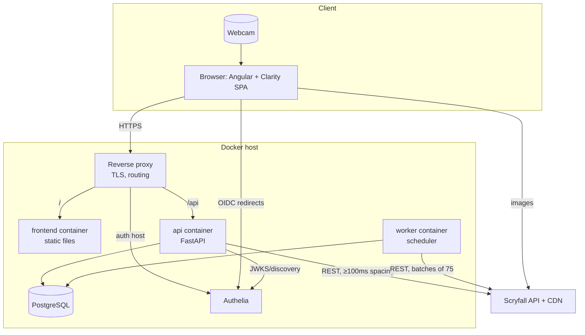
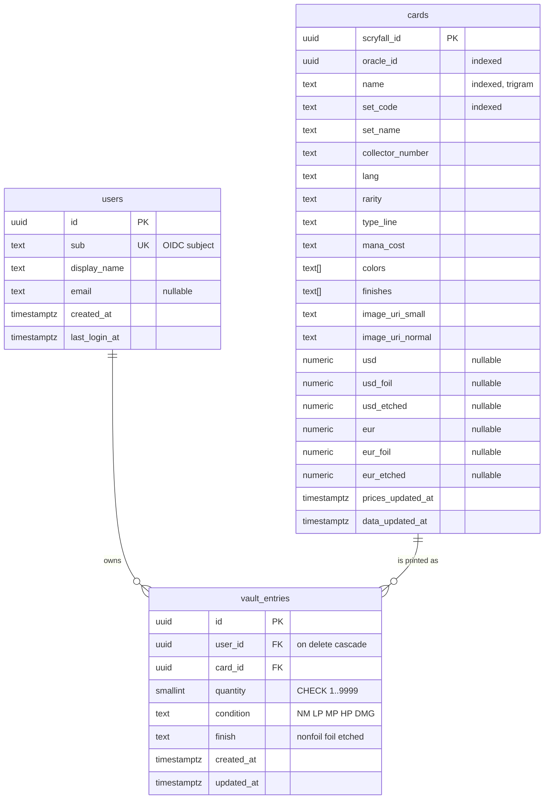
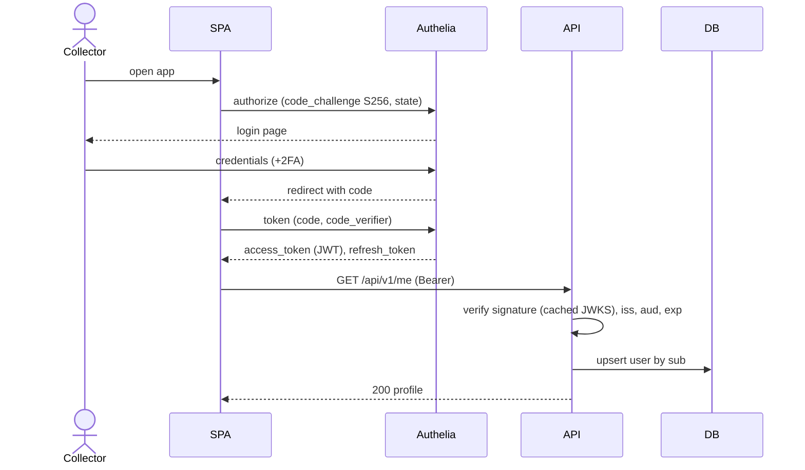
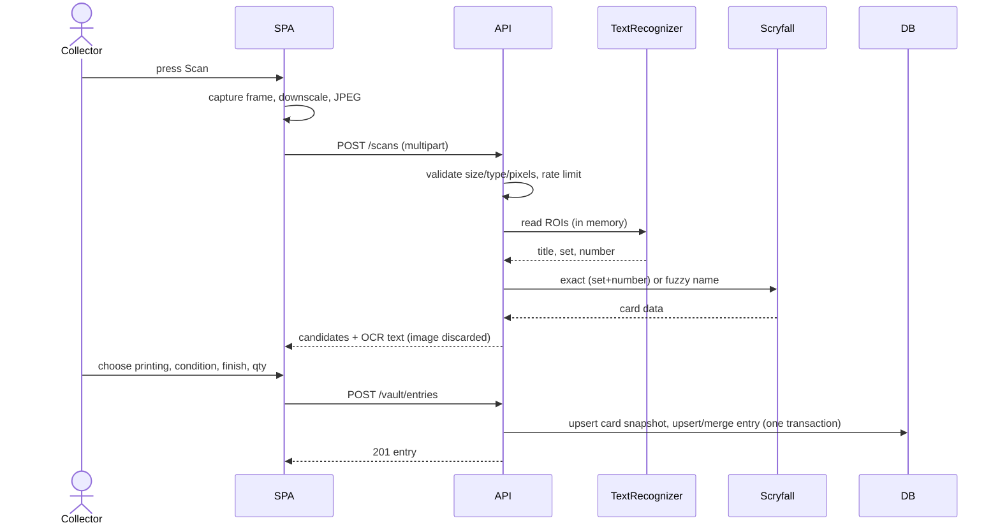
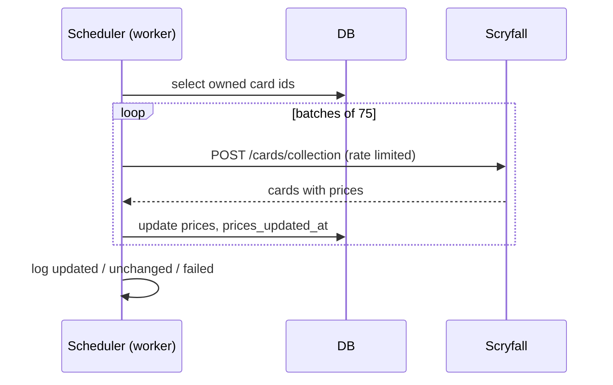
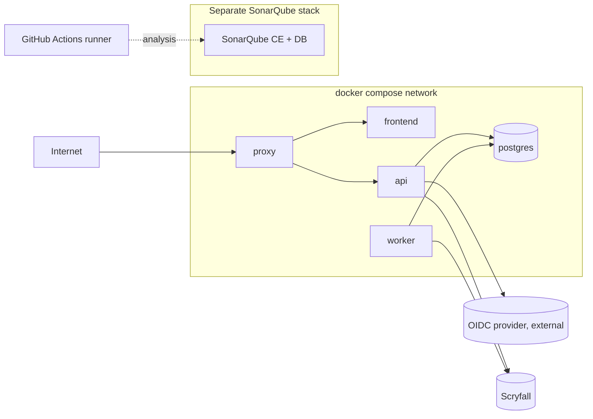

# 05 — Architecture Plan

**Docs set version:** 0.3.20
**Document:** 05 Architecture Plan (arc42 template, 12 sections; decisions as ADRs; diagrams in Mermaid)
**Status:** Draft
**Last updated:** 2026-11-07

Technology versions are intentionally written as "latest stable supported by …"; exact pins live in `pyproject.toml` / `package.json` and are recorded in the changelog when they change.

---

## 1. Introduction and goals

### 1.1 Requirements overview
MTG Card Vault lets collectors sign in through Authelia, keep a private vault of owned MTG cards, add cards by webcam (OCR + Scryfall matching, user-confirmed) or manual search, and see current prices and total value. Authoritative statements: `01` (why/scope), `02` (stories), `03` (requirements), `04` (flows).

### 1.2 Quality goals (top five, in priority order)

| # | Quality goal | Meaning here | Requirements |
|---|---|---|---|
| 1 | Security & privacy | Only authenticated users; strict data isolation; no scan images stored. | NFR-SEC-01, NFR-SEC-05, NFR-PRV-01 |
| 2 | Maintainability / testability | SOLID, DRY, KISS, YAGNY; ports and adapters; quality gate. | NFR-MNT-01, NFR-MNT-03, NFR-TST-01 |
| 3 | Correctness of card data | User-confirmed matches, Scryfall as source of truth. | FR-SCN-05, FR-DAT-02 |
| 4 | Resilience to external failure | Scryfall outage never locks the vault. | NFR-REL-01, FR-DAT-03 |
| 5 | Usability & accessibility | Clarity design code, WCAG 2.1 AA. | NFR-USA-01, NFR-USA-02 |

### 1.3 Stakeholders
See `01` §3 (`STK-01` … `STK-06`). Architecture-relevant expectations: STK-01 wants clean, demonstrable engineering; STK-03 wants a one-command deployment; STK-04/05 impose interface rules.

---

## 2. Constraints

| Type | Constraint | Source |
|---|---|---|
| Technical | Python/FastAPI back end; Angular + Clarity front end; REST; PostgreSQL; docker compose. | CON-01, CON-02, CON-03, CON-10 |
| Technical | Authelia as OIDC provider; JWT on every call. | CON-04 |
| Technical | HTTPS required for camera access. | CON-11 |
| Organizational | GitHub public repo, gitflow, semver, atomic commits, GitHub Actions. | CON-05, CON-06 |
| Organizational | Quality gates run by the project's script and decided together with SonarQube's own gate (self-hosted). | CON-07 |
| Principles | SOLID, DRY, KISS, YAGNY; full test suite. | CON-08 |
| External | Scryfall API rules and legal terms. | CON-09 |
| Privacy | Webcam images never persisted. | CON-12 |
| Conventions | Monorepo with `backend/`, `frontend/`, `docs/`, `deploy/`, `scripts/`, `.github/`. | ADR-001 |

---

## 3. Context and scope

### 3.1 Business context

| Partner | Inputs to the system | Outputs from the system |
|---|---|---|
| Collector | Credentials (to Authelia), camera frames, search text, vault edits | Vault views, candidates, prices, totals |
| Authelia | ID/access/refresh tokens, JWKS, discovery document | Authorization requests, token revocation, portal logout |
| Scryfall | Card data, printings, prices, images (CDN) | Search / lookup / collection requests |
| Operator | Configuration (`.env`), upgrades | Logs, health endpoints |

### 3.2 Technical context



Channel table: browser↔proxy HTTPS/443 · proxy↔api HTTP on internal network · api↔db TCP/5432 internal · api/worker↔Scryfall HTTPS to `api.scryfall.com` only · browser↔Scryfall CDN HTTPS for `` only (CSP allows `cards.scryfall.io`).

---

## 4. Solution strategy

| Goal / problem | Approach | Decision |
|---|---|---|
| Separate concerns, keep tests fast | Layered architecture with ports (interfaces) and adapters at the edges; domain logic free of frameworks. | ADR-006 |
| Prove the caller's identity on every call | Authelia OIDC; SPA uses code + PKCE; API validates Authelia-signed JWT locally via cached JWKS. | ADR-003 |
| Reduce manual data entry | Browser captures a frame; server-side OCR on fixed regions; Scryfall fuzzy match; user confirms. | ADR-004 |
| Accurate, current data without heavy infrastructure | Cache only owned cards; refresh daily in batches and lazily when stale. | ADR-007, ADR-012 |
| Protect privacy | Frames processed in memory and discarded. | ADR-008 |
| Avoid hand-written glue | OpenAPI is the contract; Angular client generated from it. | ADR-009, ADR-013 |
| Keep quality enforceable | Quality gate + security scans + import contracts + docs sync in CI. | ADR-010, ADR-011, ADR-014 |
| Simple operation | One compose file; env-based config; migrations on start. | ADR-001, ADR-005 |

---

## 5. Building block view

### 5.1 Level 1 — containers

| Container | Responsibility | Tech |
|---|---|---|
| `frontend` | SPA: UI, OIDC login, camera capture, generated API client. Served as static files by an unprivileged web server. | Angular, Clarity |
| `api` | REST API: authentication, use cases, Scryfall access, OCR, persistence. | Python, FastAPI |
| `worker` | Scheduled jobs (price refresh); same codebase and image as `api`, different entry command. | Python, APScheduler |
| `db` | Persistent data. | PostgreSQL |
| *(external)* Authelia | Identity provider (OIDC); operated outside this repository, not part of the compose stack. | Authelia |
| `proxy` | TLS termination, HTTP to HTTPS redirect, HSTS. | Caddy (ADR-016) |

### 5.2 Level 2 — back end (`backend/`)

```
backend/
├── pyproject.toml            # uv/pip metadata, ruff, mypy, pytest, import-linter config
├── alembic.ini
├── migrations/               # Alembic revisions
├── src/mtgvault/
│   ├── main.py               # composition root: builds app, wires dependencies
│   ├── config.py             # typed settings (pydantic-settings), fail fast
│   ├── logging_setup.py      # JSON logging with redaction
│   ├── correlation.py        # per-request correlation id (X-Request-ID)
│   ├── api/                  # DRIVING ADAPTER (HTTP)
│   │   ├── v1.py             # versioned /api/v1 router; feature routers are included here
│   │   ├── pagination.py     # shared Page[T] / PageParams (default 50, max 200)
│   │   ├── middleware.py     # correlation id + access log (ASGI)
│   │   ├── schemas/          # Pydantic request/response DTOs
│   │   ├── dependencies.py   # auth dependency, current user, service providers
│   │   └── errors.py         # exception -> problem+json mapping
│   ├── application/          # USE CASES + PORTS
│   │   ├── services/         # VaultService, CatalogService, ScanService,
│   │   │                     # PricingService, UserService
│   │   └── ports.py          # Protocols: CardRepository, VaultRepository,
│   │                         # UserRepository, CardDataProvider, TextRecognizer,
│   │                         # TokenVerifier, Clock, UnitOfWork
│   ├── domain/               # PURE BUSINESS RULES (no framework imports)
│   │   ├── model.py          # User, Card, VaultEntry, Candidate
│   │   ├── values.py         # Condition, Finish, Money, Quantity
│   │   └── rules.py          # merge rules, price selection, value calculation
│   ├── adapters/             # DRIVEN ADAPTERS (implement ports)
│   │   ├── persistence/      # SQLAlchemy models, repositories, unit of work
│   │   ├── scryfall/         # HTTP client, rate limiter, mapper
│   │   ├── ocr/              # preprocessing + engine (OQ-02)
│   │   └── auth/             # JWKS cache, JWT verifier (Authelia)
│   └── worker/               # scheduler entry point and jobs
└── tests/
    ├── unit/                 # pure, no I/O
    ├── integration/          # PostgreSQL (testcontainers) + HTTP fakes
    └── contract/             # OpenAPI conformance
```

**Dependency rules (enforced by import-linter, `NFR-MNT-03`):**
`api → application → domain`; `adapters → application, domain` (adapters implement ports); `domain` imports nothing from the project; `application` never imports `api` or `adapters`; only `main.py` knows concrete adapters (dependency injection through FastAPI `Depends`).

**How the principles are applied**

| Principle | Concrete application |
|---|---|
| **S**ingle responsibility | One service per use-case family; routers only translate HTTP ↔ DTO ↔ service call; mappers separate from clients. |
| **O**pen/closed | New OCR engine or recognition strategy = new adapter implementing `TextRecognizer`; no change to `ScanService`. |
| **L**iskov | All adapters honour the port contracts (shared contract tests run against fakes and real adapters). |
| **I**nterface segregation | Small ports (`CardDataProvider` is read-only; `Clock` only `now()`), not one fat repository. |
| **D**ependency inversion | Services depend on `Protocol`s in `application/ports.py`; concrete classes are injected at the composition root. |
| **DRY** | One Scryfall client, one error mapper, one pagination schema, OpenAPI-generated front-end client, IDs in docs not copied text. |
| **KISS** | No CQRS, no event bus, no message broker; plain services and a SQL database. |
| **YAGNY** | No price history, no sharing, no bulk import, no plugin system (see `01` §5.2). |

### 5.3 Level 2 — front end (`frontend/`)

```
frontend/src/app/
├── core/            # auth (OIDC), HTTP interceptors (token, errors), config, layout shell
├── api/             # GENERATED client from /api/v1/openapi.json (not hand-edited)
├── shared/          # small reusable presentational pieces built on Clarity
└── features/        # lazy-loaded feature areas
    ├── vault/       # datagrid, filters, summary, edit/remove
    ├── catalog/     # search, card detail, printings
    ├── scan/        # camera service, capture, candidates, confirm form
    └── account/     # profile, delete account
```

Rules: feature modules do not import each other (communicate via services in `core` or routing); all server calls go through the generated client; state is local to features using Angular signals/services (no global store until proven necessary — YAGNY); UI only uses Clarity components and tokens (`NFR-USA-01`).

### 5.4 Data model (physical)



Constraints and indexes: `UNIQUE (user_id, card_id, condition, finish)` (`FR-VLT-06`); `INDEX (user_id, created_at DESC)` for default listing; trigram index on `cards.name` for case/accent-insensitive search (`FR-VLT-05`); `users.sub` unique (`FR-AUTH-04`). Money uses `NUMERIC(10,2)`; never floating point. Language is a property of the printing (`cards.lang`), not of the entry.

### 5.5 REST API catalogue (`/api/v1`)

All endpoints require a valid bearer JWT (`FR-AUTH-05`) unless marked *public*. Errors are `application/problem+json` (`FR-API-02`).

| Method & path | Purpose | Requirement |
|---|---|---|
| `GET /me` | Current user profile; provisions the user on first call. | FR-AUTH-04 |
| `DELETE /me` | Delete my account and data. | FR-AUTH-08 |
| `GET /vault/entries` | List/filter/sort/paginate my entries. | FR-VLT-02, FR-VLT-05 |
| `POST /vault/entries` | Add (or merge into) an entry. | FR-VLT-01, FR-VLT-06 |
| `PATCH /vault/entries/{id}` | Edit quantity/condition/finish (may merge). | FR-VLT-03 |
| `DELETE /vault/entries/{id}` | Remove an entry. | FR-VLT-04 |
| `GET /vault/summary` | Totals and value, unpriced count. | FR-PRC-03 |
| `GET /catalog/cards` | Search (q, set, colors, type, rarity, page). | FR-CAT-01, FR-CAT-02 |
| `GET /catalog/cards/{scryfall_id}` | Card detail with prices. | FR-CAT-03 |
| `GET /catalog/cards/{scryfall_id}/printings` | All printings of the card. | FR-CAT-04 |
| `POST /scans` | Upload one frame; returns OCR text and ≤ 5 candidates. | FR-SCN-03, FR-SCN-04, FR-SCN-08 |
| `GET /healthz`, `GET /readyz` (*public*, outside `/api/v1`) | Liveness / readiness. | FR-OPS-01 |
| `GET /openapi.json` | API contract. | FR-API-01 |

### 5.6 Component codes (used by the traceability matrix)

| Code | Component | Location |
|---|---|---|
| FE-CORE | Front-end shell, config, interceptors, i18n | `frontend/src/app/core` |
| FE-AUTH | OIDC login/logout/renewal | `frontend/src/app/core/auth` |
| FE-VAULT | Vault feature (grid, filters, summary, edit/remove) | `features/vault` |
| FE-CATALOG | Catalogue feature | `features/catalog` |
| FE-SCAN | Camera, capture, candidates, confirm | `features/scan` |
| FE-ACCOUNT | Account feature | `features/account` |
| API-CORE | App factory, config, logging, errors, health, OpenAPI | `backend/src/mtgvault/{main,config,logging}.py`, `api/errors.py`, `api/v1/health.py` |
| API-AUTH | Auth dependency, user service | `api/dependencies.py`, `application/services/user` |
| API-VAULT | Vault routers/service/rules | `api/v1/vault.py`, `application/services/vault`, `domain/rules.py` |
| API-CATALOG | Catalogue routers/service | `api/v1/catalog.py`, `application/services/catalog` |
| API-SCAN | Scan router/service | `api/v1/scans.py`, `application/services/scan` |
| API-PRICING | Pricing service and summary | `application/services/pricing` |
| ADP-SCRYFALL | Scryfall client, limiter, mapper | `adapters/scryfall` |
| ADP-OCR | OCR preprocessing and engine | `adapters/ocr` |
| ADP-JWT | JWKS cache and token verification | `adapters/auth` |
| ADP-DB | Repositories, models, unit of work, migrations | `adapters/persistence`, `migrations` |
| WRK | Scheduler and jobs | `backend/src/mtgvault/worker` |
| INF-CI | GitHub Actions, quality gates, security tooling | `.github/workflows`, `scripts/quality_gate.py`, `scripts/run_local_gates.py`, `backend/sonar-project.properties`, `frontend/sonar-project.properties` |
| INF-DEPLOY | Compose, proxy, Authelia config, Dockerfiles | `deploy/`, `backend/Dockerfile`, `frontend/Dockerfile` |
| DOCS | Documentation set and sync script | `docs/`, `scripts/check_docs_sync.py` |

---

## 6. Runtime view

### 6.1 Sign in and first request (UC-01)



### 6.2 Scan and add a card (UC-02)



### 6.3 Scheduled price refresh (UC-08)



### 6.4 Vault listing with lazy refresh (UC-06 / UC-07)
The API reads entries joined with cards from PostgreSQL and responds immediately. If any returned card has `prices_updated_at` older than 24 h, `PricingService` schedules a background task guarded by an in-process "in-flight" set so a card is refreshed by at most one task at a time; the next request sees fresh data.

### 6.5 Error handling at runtime
Domain/application exceptions (`NotFound`, `ValidationFailed`, `UpstreamUnavailable`, `RateLimited`) are mapped to RFC 9457 documents in `api/errors.py`; unexpected errors become `500` with only a correlation id exposed; details go to structured logs.

---

## 7. Deployment view

### 7.1 Infrastructure (production, self-hosted)



| Service | Image | Exposed | Notes |
|---|---|---|---|
| proxy | Caddy (pinned by digest) | 80 and 443 (8080 and 8443 in development) | The only published service. Certificate from Caddy's local CA for `localhost`, from Let's Encrypt for a real domain; HTTP redirects to HTTPS keeping path and port; HSTS. |
| frontend | nginx-unprivileged serving built SPA | internal | Read-only; CSP with a per-response nonce, `X-Content-Type-Options`, `Referrer-Policy`, `X-Frame-Options`, `Permissions-Policy: camera=(self)`; proxies API paths to the api. |
| api | project image (non-root, slim) | internal | `/healthz`, `/readyz`; runs Alembic migrations before start. |
| worker | same image, command `python -m mtgvault.worker` | none | Profile `worker`; idle until the price refresh job exists (BL-44). |
| db | `postgres` 17 (pinned by digest) | none | On an internal network with no route out; named volume; backup stub in section 7.2a. |

### 7.2 Configuration (environment, validated at start-up)
`DATABASE_URL`, `OIDC_ISSUER_URL` (https; http only for localhost; required), `OIDC_AUDIENCE` (required), `OIDC_ALLOWED_ALGS` (default `RS256`; asymmetric algorithms only, `none` and HMAC are refused at start-up), `API_DOCS_ENABLED` (default `false`: no `/api/v1/docs` or `openapi.json` at runtime), `BIND_HOST` (default `127.0.0.1`; the image sets `0.0.0.0`), `BIND_PORT` (8000), `CORS_ORIGINS` (comma-separated explicit origins, no wildcard, no credentials; empty = no cross-origin access), `SCRYFALL_USER_AGENT`, `PRICE_REFRESH_CRON`, `PRICE_STALE_AFTER_HOURS` (24), `SCAN_MAX_BYTES` (2 MB), `SCAN_RATE_PER_MINUTE` (30), `LOG_LEVEL`. Only `.env.example` is committed.

### 7.2a Backup and restore (stub)
Until the operator runbook exists, the minimum procedure for `NFR-REL-02` is: back up with `pg_dump --format=custom --file mtgvault.dump "$DATABASE_URL"` (schema, data and the `alembic_version` row) and restore into an empty database with `pg_restore --clean --if-exists --dbname "$DATABASE_URL" mtgvault.dump`; the API applies any newer migrations itself on its next start. Scheduled backups, retention and a restore rehearsal belong to the operator runbook (milestone M6).

### 7.3 Environments
**Identity provider (issues #4, #10, #12; owner decision 2026-11-07):** every environment, including local development, signs in against the homelab Authelia (`https://auth.fchicout.dev`, Authelia 4.39.28, the version the ADR-003 spike was run against); the repository bundles no identity provider. Each environment has its own public OIDC client, registered in the homelab Authelia configuration: `mtgvault-staging` (redirect `https://staging.mtg.fchicout.dev/callback`), `mtgvault` (production, `https://mtg.fchicout.dev/callback`) and `mtgvault-local` (`https://localhost:8443/callback`), all with PKCE `S256`, the scopes `openid profile email offline_access`, RS256 JWT access tokens and the API audience `mtgvault-api` (the SPA requests it, ADR-003). The API is configured with the issuer and audience (`OIDC_ISSUER_URL`, `OIDC_AUDIENCE`, issue #15). Lifetimes are the homelab provider's, not per client; the ADR-003 values (15 minutes, 8 hours) are what the spike measured and must be re-checked against the homelab settings. Tests that need a signed-in user wait for the SPA's own sign-in (issue #17) and a dedicated test account in the homelab directory.

**Contract with the identity provider** (what an operator must provide, step by step in the operator guide of issue #65): an OIDC issuer reachable over HTTPS from the API (discovery and JWKS), one public client per environment (PKCE `S256`, the registered callback URLs above), RS256-signed JWT access tokens whose audience is the API audience, and the claims `sub` (identity key), a display name and optionally an email. The application is configured only through `OIDC_ISSUER_URL`, `OIDC_AUDIENCE` and the SPA's runtime settings.

`dev` (compose on the developer machine, signing in at the homelab Authelia), `ci` (ephemeral compose for E2E), `staging` (https://staging.mtg.fchicout.dev, follows `develop`), `prod` (https://mtg.fchicout.dev, follows `main`). Same images across environments; differences only in configuration. Staging and production are served over HTTPS only (HTTP is redirected) and deployed manually as described in `ADR-015`.

### 7.4 CI/CD pipeline (GitHub Actions)

| Workflow | Trigger | Jobs |
|---|---|---|
| `ci.yml` | PR to `develop`/`main`; push to `develop` or `main` | commit/branch policy; docs-sync; the jobs listed below; on a push, the final `publish-images` job (all others green) builds the images and pushes them to GHCR tagged with the commit SHA; it never deploys (`ADR-015`). |
| `codeql.yml` | PR and push to `develop`/`main`, weekly | CodeQL SAST for Python and TypeScript, results in the Security tab, alongside SonarQube (`NFR-SEC-04`). |
| `security-nightly.yml` | every night | rescans `develop` and `main` (when it exists): full-history secret scan, dependency audits, images built from the branch; new CVEs appear without code changes. |
| `release.yml` | tag `vX.Y.Z` (final releases only on `main`; pre-releases such as `v1.0.0-rc.1` anywhere) or a manual rehearsal | validates the tag, builds both images, scans them with Trivy (exceptions honoured), pushes multi-arch images (amd64, arm64 best effort) to GHCR as `X.Y.Z`, `X.Y` and `latest` (pre-releases: only `X.Y.Z`), writes the notes with `git-cliff`, creates the GitHub Release with the CycloneDX SBOMs attached. It never deploys. |
| `dependabot` | weekly | PRs for Python, npm, Docker, Actions dependencies. |

Jobs of `ci.yml` (job ids are the required status checks):

| Job id | What it proves | Verdict from |
|---|---|---|
| `docs-sync` | the documentation set is synchronized (`NFR-DOC-01`); runs on every pull request, also when only code changes; commits and `Implements:` markers reference defined IDs (warnings) | `scripts/check_docs_sync.py` |
| `commit-policy` | commit messages, branch name and release versions follow ADR-010 (pull requests only) | `scripts/check_commit_policy.py` |
| `gate-tests` | the quality-gate and docs-sync tooling itself works; the docs-sync script keeps at least 90 % coverage | `python -m unittest`, coverage |
| `backend-quality` | ruff, ruff format, mypy `--strict`, import-linter contracts | the tools |
| `backend-tests` | unit, contract and integration tests (real PostgreSQL via testcontainers); `coverage.xml` | pytest |
| `frontend-quality` | ESLint, Prettier, Vitest with LCOV coverage, production build | the tools |
| `quality-gate` | coverage of new code ≥ 80 %, duplicated lines ≤ 3 % (`NFR-MNT-01`) | `scripts/quality_gate.py` |
| `contract-drift` | committed `openapi.json` and generated Angular client equal what the code generates | regenerate + `git diff` |
| `e2e` | the compose stack becomes healthy and the UI works in Chromium | Playwright |
| `secret-scan` | no secrets in the full git history (`NFR-SEC-03`) | gitleaks (pinned version) |
| `dependency-audit` | security exceptions are valid and unexpired; no known vulnerability in Python dependencies and none High/Critical (production: Moderate) in npm dependencies, unless time-boxed in `security/exceptions.yaml` (`NFR-SEC-04`) | pip-audit, npm audit via `scripts/security_exceptions.py` |
| `container-scan` | images run as non-root and have no unfixed High/Critical findings unless excepted (`NFR-SEC-05`); SARIF goes to GitHub code scanning; CycloneDX SBOMs are produced as an artifact | Trivy (pinned), Syft (pinned) |
| `sonar-backend`, `sonar-frontend` | analysis published to `mtg-vault-backend` / `mtg-vault-frontend`; no open bugs, vulnerabilities or Blocker/Critical issues | `scripts/quality_gate.py sonar` (warns and passes until `SONAR_HOST_URL` and the project token - `SONAR_TOKEN` for the backend, `SONAR_FRONTEND_TOKEN` for the frontend - are configured) |

Branch protection on `main` and `develop`: PR required, required checks = all `ci.yml` jobs, linear-friendly merge (squash for features keeps atomic history; merge commits for releases/hotfixes per gitflow). The Sonar jobs must reach the self-hosted instance (self-hosted runner or tunnel if needed; `ASM-05`, `RSK-04`, `OQ-08`). SonarQube's own gate on new code decides together with the project's script (ADR-011): the same `scripts/quality_gate.py` runs on developer machines through `scripts/run_local_gates.py` and in `ci.yml`.

### 7.6 Operator quickstart (compose)
1. `cp deploy/.env.example deploy/.env` and set `POSTGRES_PASSWORD` (`openssl rand -hex 32`). For production also set `APP_HOST` to your domain, `HTTP_PORT=80`, `HTTPS_PORT=443` and, once HTTPS works, `HSTS_MAX_AGE=31536000`; ports 80 and 443 must reach the host for the certificate.
2. `docker compose -f deploy/compose.yaml up -d --build` starts database, API (which migrates the database first), front end and the proxy; `docker compose ps` shows every service healthy. Add `--profile worker` for the scheduled-jobs worker. Sign-in needs the homelab Authelia (section 7.3).
3. Open `https://<APP_HOST>[:port]/`. Development uses `https://localhost:8443`; trust the proxy's local CA once with `docker compose cp proxy:/data/caddy/pki/authorities/local/root.crt .` and import that file into your browser or system store. Plain HTTP only redirects.
4. Upgrade: pull or build the new version and run `up -d` again; migrations run on start. Back up as in section 7.2a. Only the proxy publishes ports; the database is unreachable from outside the compose network.
5. Deployment to the homelab cluster is a different path (`ADR-015`); the images are the same.
6. After any rollout run `python3 scripts/smoke_check.py https://<APP_HOST>` (or `make smoke URL=...`): HTTP redirects to HTTPS, `/healthz` and `/readyz` answer 200, the security headers of `NFR-SEC-06` and HSTS are present and no server version leaks. Exit code 1 means a check failed (issue #54).

### 7.5 Versioning and branching
Gitflow: `feature/*` → `develop` → `release/x.y.z` → `main` (tag `vx.y.z`) → back-merge to `develop`; `hotfix/*` from `main`. Conventional Commits drive the version bump (`feat` → minor, `fix` → patch, `!`/`BREAKING CHANGE` → major; pre-1.0 rules apply). Commit scopes: `auth`, `vault`, `catalog`, `scan`, `pricing`, `api`, `ui`, `deploy`, `ci`, `docs`.

Enforced conventions (`scripts/check_commit_policy.py`):
- **Commit header:** `type(scope)!: subject [IDs]`, at most 100 characters before the ID list, no trailing period. Types: `feat fix docs refactor test chore ci build perf revert spike security`. Scopes: `auth vault catalog scan pricing api ui deploy ci docs skeleton repo core db gates sonar e2e arch dev github frontend backend docs-sync release security deps deps-dev`. `feat` and `fix` should cite a story or requirement ID (a warning today, an error with `--require-ids error` once the history is clean). Merge, revert and fixup commits are exempt.
- **Pull-request branches:** `feature/<name>`, `release/X.Y.Z`, `hotfix/X.Y.Z`, `develop`, `main`, `dependabot/*`; the version of a release or hotfix branch is valid SemVer and newer than the latest `vX.Y.Z` tag.
- **Tags:** `vMAJOR.MINOR.PATCH`, optionally with a SemVer pre-release such as `v1.0.0-rc.1`.
- **Release dry run:** `make next-version` and `make changelog-preview` (`git-cliff`, config in `cliff.toml`); the changelog is written on the release branch.
- **Release procedure (gitflow, issue #11):** (1) `git switch -c release/X.Y.Z develop`; `make next-version` shows the version the commits imply. (2) On that branch only fixes, the docs set version and the changelog (`uvx git-cliff --bump --unreleased -o CHANGELOG.md`) change. (3) Merge `release/X.Y.Z` into `main` with a merge commit and tag it `vX.Y.Z` on `main`; pushing the tag runs `release.yml`. (4) Back-merge `main` into `develop`; delete the release branch. (5) Deploy with the operator playbook when ready (`ADR-015`). Rehearsal: run `release.yml` manually with a version such as `v0.0.0-rc.1`; it builds, scans and writes notes and SBOMs but pushes and releases nothing. Hotfixes follow the same steps from `hotfix/X.Y.Z` cut from `main`.

---

## 8. Cross-cutting concepts

### 8.1 Authentication and authorization
- SPA = public OIDC client, Authorization Code + PKCE (S256), tokens in memory, refresh token rotation (`FR-AUTH-01`, `FR-AUTH-03`); it requests the API audience explicitly and signs out by revoking the refresh token and visiting Authelia's logout page (`ADR-003`, `FR-AUTH-02`).
- API = resource server. `TokenVerifier` port, implemented by `adapters/auth`: downloads discovery + JWKS from the issuer, caches keys, refreshes on unknown `kid` (rate-limited), enforces algorithm allow-list, `iss`, `aud`, `exp`, `nbf` (`FR-AUTH-05`). Authelia does issue JWT access tokens (`OQ-05`, `ADR-003`); token introspection stays a possible adapter behind the same port. Behaviour (issue #15): the whole `/api/v1` router depends on `current_principal` (401 `problem+json` with `WWW-Authenticate: Bearer`, plus `error="invalid_token"` when a token was presented; 403 for authenticated-but-forbidden; the validation reason is logged, never returned); keys are cached 10 minutes, an unknown `kid` refreshes at most once per 30 s, cached keys survive an identity-provider outage for up to 24 h and after that the API answers 503, not 401; only `/healthz` and `/readyz` are public, and `/api/v1/docs` plus `openapi.json` are served only when `API_DOCS_ENABLED=true`; the temporary `/hello` route is removed.
- Authorization = ownership. The current user id comes only from the verified `sub` (`FR-VLT-07`); repositories require `user_id` in every query method (no unscoped access API exists).
- "Only the front end may call the API": enforced by (a) the token audience bound to the SPA's client, (b) CORS allow-list, (c) no cookie auth (so no CSRF surface). A token is the security boundary; network origin cannot be proven for non-browser clients (`NFR-SEC-01` limitation).

### 8.2 Security hardening
Input validation by Pydantic; ORM with bound parameters; upload limits and decompression-bomb guard (`FR-SCN-08`); SSRF prevention by calling only configured hosts; security headers (`NFR-SEC-06`); secrets only through environment; non-root containers; dependency, secret and image scanning in CI (policy below); SonarQube SAST.

**Content-Security-Policy recipe (verified on the production build with Clarity 18.5.0, `NFR-SEC-06`):** `default-src 'self'; script-src 'self'; style-src 'self' 'nonce-<per response>' 'sha256-<Clarity style>'; img-src 'self' data:; font-src 'self' data:; connect-src 'self'; object-src 'none'; base-uri 'self'; frame-ancestors 'none'; form-action 'self'`. How it is met: the production build does not inline critical CSS (`optimization.styles.inlineCritical: false`), which removes every inline script and style from `index.html`; `<app-root ngCspNonce="__CSP_NONCE__">` lets Angular tag the styles it injects, and the front-end server substitutes one random nonce per response (nginx `sub_filter` with `$request_id`) in both the page and the header, so the policy holds behind any proxy; Clarity's web components inject one static shadow-DOM style (`:host{all:initial;…}`) that is allowed by its hash, which the spike script prints and which must be re-derived on every Clarity upgrade. No `unsafe-inline` and no `unsafe-eval`.

**DevSecOps policy (issue #14):** thresholds - secrets: any finding fails (full history, scanner version pinned); Python dependencies: any known vulnerability fails; npm: High/Critical fail (production dependencies: Moderate and above); images: unfixed-ignored High/Critical fail. Scanner versions are pinned so a new scanner release never changes the verdict by itself; the vulnerability databases are always current, which is why the nightly workflow exists. **Exceptions:** `security/exceptions.yaml` is the only way to accept a finding. Each entry has `id`, `tool` (`trivy`, `pip-audit`, `npm-audit`), `justification`, `owner` and `expires` (at most 90 days ahead); `scripts/security_exceptions.py check` fails CI as soon as an entry expires, and the same script feeds the active ids to pip-audit, Trivy and npm audit. An empty list is the goal. **Third-party images:** the images the stack pulls (proxy, database) are scanned in every CI run as a warning, not a gate: their findings are mostly toolchain versions inside the upstream image, which only an upstream rebuild can fix; Dependabot proposes the digest updates, and the images we build ourselves stay under the blocking gate above. **Code scanning:** Trivy results (SARIF) and CodeQL appear in the repository's Security tab. **SBOM:** Syft writes CycloneDX documents for both images on every CI run; releases attach them (issue #11).

### 8.3 Error handling
Typed domain exceptions (`domain/errors.py`: `NotFound` 404, `ValidationFailed` 422, `Conflict` 409, `RateLimited` 429 with `Retry-After`, `UpstreamUnavailable` 503) → problem+json with correlation id (`FR-API-02`). Problem `type` is `urn:mtgvault:problem:<slug>`; request-validation errors list the offending fields in `errors`; framework HTTP errors (404, 405, …) use the same document; an unexpected exception becomes a generic `500` whose message and stack trace only go to the log. The SPA has one HTTP error interceptor that maps problem documents to Clarity alerts.

### 8.4 Logging and observability
JSON logs on stdout; correlation id middleware accepts `X-Request-ID` only when it matches `[A-Za-z0-9._-]{1,128}` (otherwise a new id is generated) and returns it in the response header and in every error document; one access-log line per request carries method, path (never the query string), status and duration; redaction of tokens, e-mails, secret-named fields and image data runs on every record before formatting (`FR-OPS-02`); health endpoints. Metrics/tracing are deliberately not in v1 (YAGNY).

### 8.5 Persistence and transactions
One unit of work per request; entry add/merge/edit and account deletion are single transactions; optimistic concurrency not required (last write wins) except the unique constraint handling for merges (retry once on conflict).

### 8.6 Caching and rate limiting
In-memory TTL cache for catalogue searches (5 min). Cards cached in PostgreSQL for owned printings only (`ADR-007`). Process-wide token-bucket limiter around Scryfall (≥ 100 ms spacing). Per-user rate limit on scans (30/min), implemented behind a small interface (in-memory now; replaceable by Redis if the API ever scales out).

### 8.7 Configuration management
`pydantic-settings`; fail fast; no defaults for secrets. An invalid environment makes the process exit with code 2 and a message naming each offending variable (never its value).

### 8.8 Testing strategy (`NFR-TST-01`)

| Level | Scope | Tools | Notes |
|---|---|---|---|
| Unit | domain rules, services with fake ports, OCR preprocessing, query translation, front-end components/services | pytest, Angular test runner | No I/O; bulk of tests; fast. |
| Integration | repositories + migrations on real PostgreSQL; API with `httpx` against the ASGI app; Scryfall/JWKS faked | pytest, testcontainers, respx | Includes migration up/down and ownership isolation tests. |
| Contract | OpenAPI document vs. responses; generated client up to date | schemathesis / schema diff | Fails the build on drift. |
| End-to-end | sign in (homelab Authelia, with the identity milestone), scan with fake camera stream and fixture image, add, edit, remove, value | Playwright (Chromium `--use-fake-device-for-media-stream`), axe | Runs against ephemeral compose. |
| OCR accuracy | 100-card reference image set measuring top-3 hit rate (`BO-02`) | pytest marker `accuracy` | Nightly / on-demand, not a PR gate. |

Quality gates are evaluated by `scripts/quality_gate.py` (`NFR-MNT-01`): coverage of new code ≥ 80 %, duplicated lines ≤ 3 % (computed locally with jscpd) and, from SonarQube's issue data, no open bugs, vulnerabilities or Blocker/Critical issues. `scripts/run_local_gates.py` runs every CI gate locally.

**End-to-end harness (issue #12):** Playwright in `frontend/e2e` against a running stack (`deploy/compose.yaml`; in CI an ephemeral stack). Browsers: Chromium, Firefox and WebKit (`E2E_BROWSERS` narrows them). Helpers in `e2e/support`: `axe.ts` (`expectNoSeriousViolations`, WCAG 2.1 A/AA, proven to fail on a seeded violation), `scryfall.ts` (record/replay: fixtures in `e2e/fixtures/scryfall`, an unrecorded request is blocked and reported so the real service is never contacted; record one with `E2E_RECORD=1`), `fake-camera.ts` (Chromium only: `--use-fake-device-for-media-stream --use-fake-ui-for-media-stream --use-file-for-fake-video-capture`; the fixture video is **generated** before each run, a dark scene with a card-shaped rectangle and a marker that moves every frame, 320 x 240 at 15 fps, so a test can prove that distinct frames reach `getUserMedia`). A failure keeps its trace, video and screenshot as CI artifacts; at most one retry.

### 8.9 UI concepts
Clarity components only; datagrid with server-side pagination/filtering; consistent loading/empty/error states; keyboard accessibility; i18n-ready strings. The application shell (`frontend/src/app`, issue #9) is Clarity's responsive main container: header (product name, light/dark theme toggle that follows the system until the user chooses), a vertical navigation with Vault, Catalogue, Scan and Account, the content area (alerts first, then the routed page) and a footer on every page with the Scryfall attribution and the unofficial Fan Content notice (`NFR-LEG-01`). Pages are lazy standalone routes with their own document title; unknown addresses show a 404 page and a sign-in-required page exists for the identity milestone. Three small patterns serve every view: `app-loading-state`, `app-empty-state` (heading, explanation and actions are projected) and `app-error-state` (message and retry). **Errors:** one HTTP interceptor turns every failed call into a Clarity alert in plain language per status (never the server's wording), with fields for `422` and the wait time for `429`; a collapsed "Support details" section shows the status, the technical title and detail and the correlation id (`FR-API-02`); the same failure is not shown twice in a row, a request may opt out with `HANDLES_OWN_ERRORS`. **i18n:** every visible string is an Angular i18n message with a stable id (`$localize` in code, `i18n` in templates); `npm run i18n:extract` writes `src/locale/messages.xlf` and CI fails when the messages (not their source line numbers) differ from the code, so another language only needs a translated file (`NFR-USA-04`). **Accessibility:** E2E runs axe (WCAG 2.1 A/AA) on every route in both themes and at 768 px and fails on serious or critical findings (`NFR-USA-02`, `NFR-USA-03`).

### 8.10 Documentation as part of the architecture
The six-document set is versioned with the code and mechanically checked (`ADR-014`, `NFR-DOC-01`).

---

## 9. Architecture decisions (ADRs)

Format: Status · Context · Decision · Consequences · Alternatives. Statuses: Proposed, Accepted, Superseded. Never delete an ADR; supersede it.

### ADR-001 — Monorepo with folder-split front end and back end
- **Status:** Accepted
- **Context:** One developer, tightly coupled API contract, single set of docs and CI. CON-03 demands separate folders in one repository.
- **Decision:** One git repository with `backend/`, `frontend/`, `docs/`, `deploy/`, `scripts/`.
- **Consequences:** Atomic cross-stack commits; one CI; path filters keep jobs fast. Tooling must handle two ecosystems.
- **Alternatives:** Two repositories (rejected: sync overhead, contract drift).

### ADR-002 — FastAPI for the back end
- **Status:** Accepted
- **Context:** Need async I/O (HTTP to Scryfall, DB), typed validation, OpenAPI for client generation, good DI for SOLID.
- **Decision:** Python with FastAPI, Pydantic v2, SQLAlchemy 2.x, Alembic, pytest.
- **Consequences:** Automatic OpenAPI; dependency injection via `Depends`. Discipline needed to keep business logic out of routers.
- **Alternatives:** Django+DRF (heavier, ORM-centric), Flask (assemble everything yourself).

### ADR-003 — Authelia OIDC, PKCE, locally validated JWT
- **Status:** Accepted (verified by the spike of issue #4 on Authelia 4.39.28, resolves `OQ-05`)
- **Context:** CON-04 and the requirement that every call be authenticated and only the front end may call the API. A browser SPA cannot keep a client secret.
- **Decision:** Authelia is the OpenID Connect provider. The SPA is a public client with Authorization Code + PKCE (`S256`, enforced) and refresh-token rotation. Authelia is configured with `access_token_signed_response_alg: RS256`, which makes access tokens **JWTs** (`typ: at+jwt`, RFC 9068, `kid` published in the JWKS) carrying `iss`, `aud`, `sub` (a stable UUID per user), `client_id`, `scp`, `iat`, `nbf`, `exp` and `jti`. The API validates them locally (JWKS, `iss`, `aud`, `exp`, `nbf`, RS256 allow-list). **Audience:** the client's `audience` setting is only the list of audiences it may *request*; the SPA must send `audience=<API audience>` on every authorization request (for example through the OIDC library's extra query parameters), otherwise the token has no API audience. Dev audience: `mtgvault-api`. **Lifetimes:** access token 15 minutes, refresh token 8 hours, rotated on every use; ID token 15 minutes. **Sign-out:** Authelia advertises no OIDC `end_session_endpoint`, so the SPA discards its tokens, revokes the refresh token at the revocation endpoint and sends the browser to `<authelia>/logout?rd=<application URL>` (the target must be inside the cookie domain), which ends the SSO session. **Failure handling:** a refresh that is rejected, revoked or reused answers HTTP 400 `invalid_grant` or, in some cases, HTTP 500 (upstream issue authelia/authelia#13390); the SPA treats any failed refresh as "sign in again". Re-using an authorization code revokes every token issued from it.
- **Consequences:** No self-minted tokens, no shared secret, stateless API. Token revocation relies on the 15-minute lifetime (a revoked refresh token stops renewal, an access token stays valid until it expires). "Only the front end" is enforced through audience + CORS, not network proof (documented limitation). Verified once end to end (30 checks: claims, RS256 signature against the JWKS, refresh rotation, revocation, PKCE enforcement, two-user isolation, portal logout) against a throwaway Authelia 4.39.28 on 2026-11-07; the homelab provider runs the same version.
- **Alternatives:** Forward-auth + backend-minted JWT (more custom security code); opaque tokens with introspection (extra call per request; the `TokenVerifier` port keeps this possible without changing services).

### ADR-004 — OCR plus Scryfall fuzzy match, always user-confirmed
- **Status:** Accepted (engine choice pending OQ-02)
- **Context:** Need low-effort card entry with imperfect webcam images.
- **Decision:** Browser captures a guided frame; the API OCRs fixed regions (title, set code, collector number) and resolves via Scryfall (exact by set+number, else fuzzy name); returns ≤ 5 candidates; the user confirms.
- **Consequences:** No ML training or large local index; accuracy depends on image quality (RSK-01), mitigated by confirmation and manual fallback. OCR sits behind the `TextRecognizer` port so the engine is replaceable.
- **Alternatives:** Perceptual-hash/embedding image matching against a Scryfall image index (heavier infrastructure); hybrid (YAGNY for v1).

### ADR-005 — PostgreSQL with SQLAlchemy and Alembic
- **Status:** Accepted
- **Context:** Multi-user relational data, concurrency, constraints, trigram search.
- **Decision:** PostgreSQL; SQLAlchemy 2.x ORM behind repository ports; Alembic migrations run on start.
- **Consequences:** Integration tests need real PostgreSQL (testcontainers). Strong integrity guarantees (unique/check constraints).
- **Alternatives:** SQLite (limited concurrency/search features).
- **Notes (issue #8):** *Synchronous* SQLAlchemy 2.x with `psycopg` 3, not async: simpler transactions and Alembic, a small user group (`ASM-06`), and FastAPI runs sync endpoints in a thread pool. The `UnitOfWork` port keeps this an adapter detail, so moving to async later does not touch use cases. A unit of work is one session and one transaction; leaving it without `commit()` rolls back. Constraint names follow a fixed naming convention so migrations are deterministic. The container entry point (`python -m mtgvault.serve`) runs `alembic upgrade head` under a PostgreSQL advisory lock and only then starts the HTTP server; if a migration fails the process exits non-zero and never listens (`FR-OPS-03`). Integration tests use one PostgreSQL per test session and a fresh database per test.

### ADR-006 — Layered architecture with ports and adapters
- **Status:** Accepted
- **Context:** Need testability, SOLID, replaceable external systems, without ceremony.
- **Decision:** Layers `api → application → domain`, adapters implementing application ports; composition root in `main.py`; import contracts enforced in CI.
- **Consequences:** Fast unit tests with fakes; slightly more files than a flat app.
- **Alternatives:** Full hexagonal/DDD with aggregates and domain events (excess for this domain); flat Django-style app (couples logic to framework).

### ADR-007 — Cache only the printings users own
- **Status:** Accepted
- **Context:** Scryfall bulk data is ~500 MB and needs a heavy import; the API suffices for search.
- **Decision:** Search proxies Scryfall (short TTL cache); a printing is persisted locally only when added to a vault; prices refreshed daily and lazily.
- **Consequences:** Small database; catalogue search needs Scryfall online; vault works offline from cache (`FR-DAT-03`).
- **Alternatives:** Bulk import (offline search, but heavy; revisit if rate limits hurt).

### ADR-008 — Scan images are never stored
- **Status:** Accepted
- **Context:** Privacy and operational simplicity (`CON-12`).
- **Decision:** Frames live only in request memory; excluded from logs; only recognised text and the confirmed card persist.
- **Consequences:** No object storage, retention policy or breach surface for photos; no re-processing of old scans; debugging relies on fixtures, not production images.
- **Alternatives:** Store images for condition proof (rejected for v1).

### ADR-009 — Angular + Clarity, API client generated from OpenAPI
- **Status:** Accepted (version pin decided 2026-11-07, resolves `OQ-01`)
- **Context:** CON-02; avoid hand-written HTTP glue (DRY). Clarity declares the Angular majors it supports in its `peerDependencies`.
- **Decision:** Angular **22.2.x** with Clarity **18.5.x** (`@clr/angular`, `@clr/ui`; `@cds/core` 6.17). Clarity 18.5.0 declares support for Angular `^21.1 || 22`, and Angular 22.2.5 is the newest release, so the project runs the newest supported pairing. Clarity components only; the API client is generated from `openapi.json` in CI and drift fails the build. Package manager: **npm 11.19.1**, pinned by `packageManager`, with the lockfile committed (a different npm major rewrites the lockfile). Unit-test runner: **Vitest** through `ng test`. No server-side rendering: the SPA is static files behind the reverse proxy, which keeps the CSP simple. Evidence: branch `spike/clarity-sample` (sample shell, datagrid, modal, validated form, alert, icons, theme toggle) driven in Chromium with zero console messages, zero CSP violations and a clean axe run in both themes.
- **Upgrade policy:** (1) Patch and minor updates arrive as weekly Dependabot PRs and merge when CI is green. (2) An Angular **major** is adopted only after `npm view @clr/angular peerDependencies` lists it; never ahead of Clarity. (3) Every Clarity or Angular upgrade must pass the E2E suite with axe and the CSP check below, and re-derive the Clarity style hash. (4) The pin and its date are updated in this ADR and in the changelog.
- **Findings that shape the UI code:** control errors need `ClrForm.markAsTouched()` on submit (status events alone do not trigger Clarity's messages); numbers use `clr-number-input-container`; header actions are anchors (`a.nav-link`), because a native `button` gets a light background that fails contrast; `clr-vertical-nav` needs `role="navigation"` and a label to satisfy the landmark rule; `ClrFormsModule` (not `ClrForm`) is the import.
- **Consequences:** Contract changes surface immediately as compile errors in the SPA; Clarity's release cadence limits how fast Angular majors can be adopted (`RSK-03`).
- **Alternatives:** Hand-written services (drift risk); staying on an older Angular for a longer time (rejected: no security patches).

### ADR-010 — Gitflow, semantic versioning, Conventional Commits
- **Status:** Accepted (release tooling decided 2026-11-07, resolves `OQ-04`)
- **Context:** CON-05. Releases are a deliberate human act (nothing is deployed automatically) and gitflow uses short-lived `release/*` branches.
- **Decision:** Gitflow branches; SemVer tags `vX.Y.Z`; Conventional Commits with story IDs; atomic commits. `scripts/check_commit_policy.py` enforces message format, project scopes, ID references (warning for now), branch names and tag/branch SemVer in CI (`commit-policy` job) and locally (commit-msg hook). **Release tooling: `git-cliff` with manual tags.** `git-cliff` reads the Conventional Commits and proposes the next version (`feat` → minor, `fix` → patch; before 1.0 a breaking change bumps the minor version) and writes the changelog; the maintainer creates the release branch, runs the dry run, merges to `main` and tags. Dry run on the current history: next version `v0.1.0`.
- **Consequences:** Predictable history and generated notes without a bot opening PRs or tagging by itself; requires discipline and protected branches. The checker is dependency-free Python with unit tests.
- **Alternatives:** `release-please` (automated release PRs on one branch, a poor fit for gitflow's `release/*` and `develop`), `semantic-release` (publishes automatically from a branch, against the manual-release rule), trunk-based development (user mandated gitflow), Node `commitlint` (adds an npm toolchain to a Python-centred tooling set).

### ADR-011 — Quality gates: the project's script and SonarQube's own gate decide together
- **Status:** Accepted; amended 2026-11-07 (owner decision): SonarQube's own gate now decides too. Topology final (`OQ-08` resolved).
- **Context:** CON-07. The first decision kept SonarQube's own gate out of the verdict because a read-only token on the shared Sonar instance could not read gate status, so a server-side gate would have given different verdicts to different callers. With a dedicated scan token per project that reason no longer holds (the status is readable in CI), and the script judged a narrower set than the server's gate: it ignored non-blocking *new* issues, so the dashboards showed *Failed* (`new_violations` 6 and 4) while the pipeline was green. The owner chose one rule, the server's, behind the dashboard badge.
- **Decision:** `scripts/quality_gate.py` holds the conditions and thresholds of `NFR-MNT-01`; `scripts/run_local_gates.py` and `ci.yml` run it identically. **SonarQube's own quality gate ("Sonar way" on new code) is one of its conditions**: the `sonar-*` jobs fail when the server's gate is not OK and fail closed when its status cannot be read, printing the failing conditions and the new-code issues behind them. The script's own conditions remain as a floor that also runs on developer machines. SonarQube Community (self-hosted) analyses two projects, `mtg-vault-backend` and `mtg-vault-frontend`, and serves issue data; the scanner runs in a container in CI. Coverage of new code is computed from the git diff and the coverage reports; duplication with jscpd; bugs, vulnerabilities and Blocker/Critical issues from Sonar's issue search.
- **Consequences:** Gate logic is versioned and unit-tested; every new-code issue SonarQube reports (any severity) must be fixed, or reviewed in SonarQube with a reason, before a change can merge; whether the Community Build supports pull-request analysis (OQ-08) only affects where analysis results are published. The maintainability rating needs a token that may read measures; without it the condition is reported SKIPPED, never passed. There is no hotspot condition: Security Hotspots are deprecated in SonarQube (26.7, the `/api/hotspots/*` endpoints included) and become ordinary security issues (26.11), and the rules that raised them already raise vulnerabilities for several languages (26.6), so the gate counts every open issue with a security impact (`impactSoftwareQualities=SECURITY`, or type `VULNERABILITY` on servers without that facet) and a migrated hotspot is picked up automatically. Sonar projects and a scan token must be provisioned by a Sonar admin.
- **Alternatives:** Keeping the server's gate informational (the original decision, replaced by the owner's amendment); SonarCloud as the analysis source (possible fallback).
- **Topology (final):** SonarQube Community Build 26.10 runs in the homelab and is reachable over HTTPS at `https://sonar.fchicout.dev`; the scanner (official action, pinned) runs on GitHub-hosted runners. Two projects exist, `mtg-vault-backend` and `mtg-vault-frontend`, each with its own scan token stored as a GitHub secret (`SONAR_TOKEN`, `SONAR_FRONTEND_TOKEN`) beside `SONAR_HOST_URL`; both `sonar-*` jobs are required checks. The Community Build has no branch or pull-request analysis: every analysis, including those of pull requests (repository variable `SONAR_PR_ANALYSIS=true`), is published to the project's single branch and the gate reads the result of that run right after the scan, so a verdict never depends on an earlier run. Generated code (the API client, `openapi.json`) is excluded; migrations and tests are not analysed as sources. The gate has failed real changes through this script (for example `python:S8392` on a server bound to all interfaces, and a Web mouse-event-without-keyboard bug), and now also through SonarQube's own gate (new issues of any severity).
- **Hotspots:** retired from the gate (2026-11-07). The scan tokens always received HTTP 403 from the deprecated hotspots API; since hotspots are being folded into issues, the right fix was to stop depending on that API, not to widen the token. Existing legacy hotspots, if any, can be reviewed in the SonarQube UI until the 26.11 migration converts them.

### ADR-012 — Scheduler runs in a separate worker container
- **Status:** Proposed
- **Context:** Daily price refresh must not depend on API replicas or request traffic.
- **Decision:** `worker` container from the same image runs APScheduler with the refresh job; API-triggered lazy refreshes use in-process background tasks.
- **Consequences:** Simple, no broker. If the API is scaled out later, lazy-refresh de-duplication must move to a shared store.
- **Alternatives:** In-API scheduler (duplicates when scaled), Celery/Redis (YAGNY), OS cron (outside the stack).

### ADR-013 — RFC 9457 problem+json errors
- **Status:** Accepted
- **Context:** Uniform, machine-readable errors for the generated client and the UI.
- **Decision:** All errors use `application/problem+json` with correlation id.
- **Consequences:** One mapping module; SPA has a single error interceptor.
- **Alternatives:** Ad-hoc JSON errors.

### ADR-014 — Documentation is a synchronized specification, checked in CI
- **Status:** Accepted
- **Context:** The user mandates full and rigorous sync across charter, stories, requirements/use cases and architecture; docs must let an LLM understand the product.
- **Decision:** Stable IDs, shared docs-set version, traceability matrix, and `scripts/check_docs_sync.py` as a required check; docs updated in the same PR as code.
- **Consequences:** Slight overhead per change; semantic consistency still needs human review.
- **Alternatives:** Free-form docs (drift), generated docs only (lose intent).

---

### ADR-015 — Staging and production on the homelab cluster, deployed manually
- **Status:** Accepted (amended 2026-11-07: automated deployment withdrawn)
- **Context:** The project needs real environments: staging follows `develop`, production follows `main`, both on the operator's K3s cluster (`CON-10`) and reachable only over HTTPS (`CON-11`). The owner wants every release to be a deliberate, human-controlled act and no cluster credentials or cluster API exposure on GitHub.
- **Decision:** The environment infrastructure (namespaces, database, TLS, secrets, access control) is managed outside this repository. CI (the `publish-images` job of `ci.yml`, after every other job is green on a push to `develop` or `main`) only builds images tagged with the immutable commit SHA and pushes them to GHCR; it never deploys. After the work is tested and done, the operator runs the infrastructure playbook locally with that SHA, then verifies the site over HTTPS (health endpoints answer and plain HTTP only redirects to HTTPS). No deployment credentials are stored in GitHub.
- **Consequences:** A release needs one manual command; there is no continuous deployment and no cluster API exposure. Image names and tags are the contract between this repository and the infrastructure.
- **Alternatives:** Push from GitHub Actions with a restricted credential (rejected by the owner: exposes the cluster API and holds credentials in GitHub), pull-based deploys from the cluster (Rundeck), or a GitOps controller; revisit if releases become frequent.

---

### ADR-016 — Caddy as the TLS edge; security headers in the front-end server
- **Status:** Accepted (resolves `OQ-03`)
- **Context:** The stack needs HTTPS everywhere (`CON-11`: browsers expose the camera only on secure origins), a certificate story for development and for production, and the same security headers whatever sits in front of the application (the homelab deployment uses Traefik, the compose stack needs its own proxy).
- **Decision:** **Caddy** is the only published service of the compose stack: automatic certificates (its own local CA for `localhost`, Let's Encrypt for a real `APP_HOST`), an explicit HTTP to HTTPS redirect that keeps path and port, and HSTS (short by default, one year once HTTPS is proven). Everything else - the CSP with its per-response nonce, `nosniff`, `Referrer-Policy`, `X-Frame-Options` and `Permissions-Policy: camera=(self)` - is set by the front-end server, so a different proxy changes nothing. The database sits on an internal network, containers are read-only with all capabilities dropped except those their entrypoints need, and base images are pinned by digest.
- **Consequences:** One small, readable proxy file; certificates need no operator tooling; a developer trusts Caddy's local root once. Header and CSP regressions fail the E2E `security` spec.
- **Alternatives:** Traefik (powerful, but label-driven configuration and a separate ACME setup for a single-site stack); headers at the proxy only (would be lost behind another proxy).

---

## 10. Quality requirements

### 10.1 Quality tree

| Quality | Sub-quality | Requirement IDs |
|---|---|---|
| Security | Authentication, access control, privacy, supply chain | NFR-SEC-01 … NFR-SEC-07, NFR-PRV-01 |
| Performance | Latency of list and scan, load time | NFR-PRF-01 … NFR-PRF-03 |
| Reliability | Degradation, migrations | NFR-REL-01, NFR-REL-02 |
| Usability | Clarity, accessibility, responsiveness, i18n | NFR-USA-01 … NFR-USA-04 |
| Maintainability | Gates, static analysis, architecture rules, process | NFR-MNT-01 … NFR-MNT-04, NFR-TST-01, NFR-DOC-01 |
| Portability | One-command deployment, browser support | NFR-PRT-01, NFR-CMP-01 |
| Compliance | Scryfall / WotC terms | NFR-LEG-01 |

### 10.2 Quality scenarios

| # | Scenario (stimulus → response) | Measure |
|---|---|---|
| Q1 | A request arrives with a token signed by an unknown key. | `401`; no data returned; logged with correlation id. |
| Q2 | User A requests user B's entry id. | `404`; no information leak. |
| Q3 | Scryfall returns 429 during a price refresh. | Back-off honouring `Retry-After`; no ban; completes on next run. |
| Q4 | Scryfall is down while a user opens the vault. | Vault renders from cache with stale-price flag. |
| Q5 | A 20 MB image or a decompression bomb is uploaded to `/scans`. | Rejected before OCR; memory stays bounded. |
| Q6 | A developer imports an adapter from the domain layer. | import-linter fails the CI build. |
| Q7 | A story changes without updating the matrix. | docs-sync check fails the PR. |
| Q8 | The OCR engine must be replaced. | New adapter + config change; no change in `ScanService` or API. |

---

## 11. Risks and technical debt

Risks are tracked in `01` §9 (`RSK-01` … `RSK-10`) and open questions in `01` §12 (`OQ-01` … `OQ-08`); architecture-relevant ones: RSK-01 (OCR), RSK-02 (Scryfall), RSK-03 (Clarity vs Angular), RSK-04 (CI ↔ SonarQube), RSK-05 (Authelia JWT). Known technical debt: none yet (greenfield). Debt discovered later is recorded here as a table with an owner and a target milestone.

---

## 12. Glossary
See `03` Appendix A.
